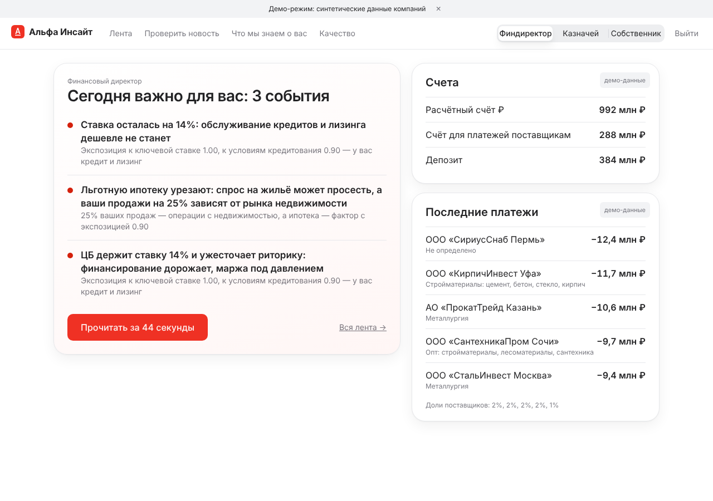
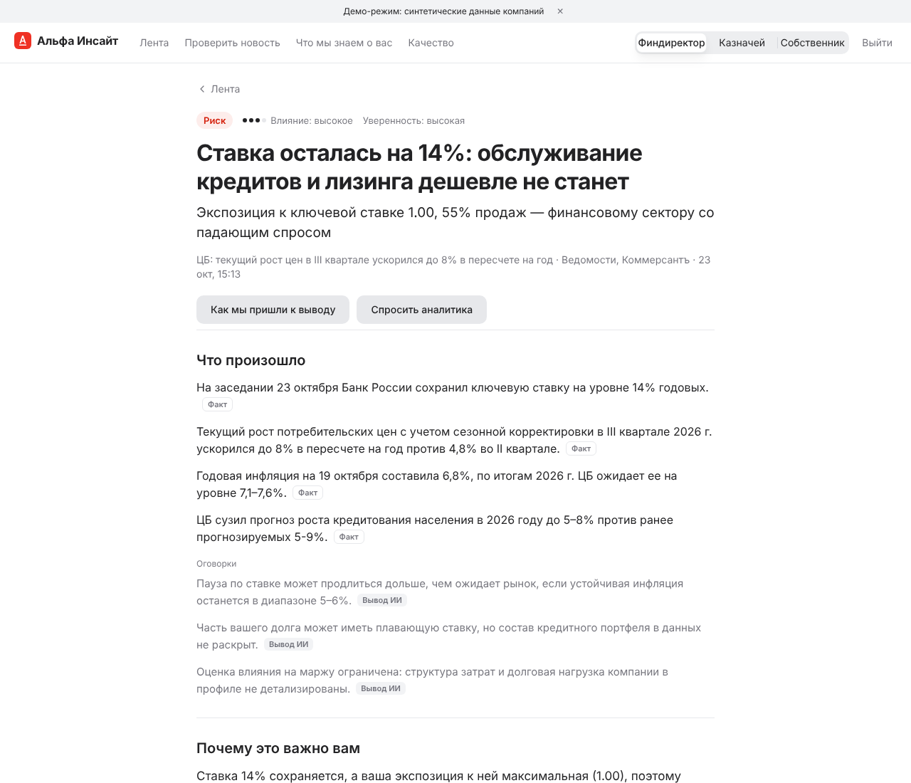
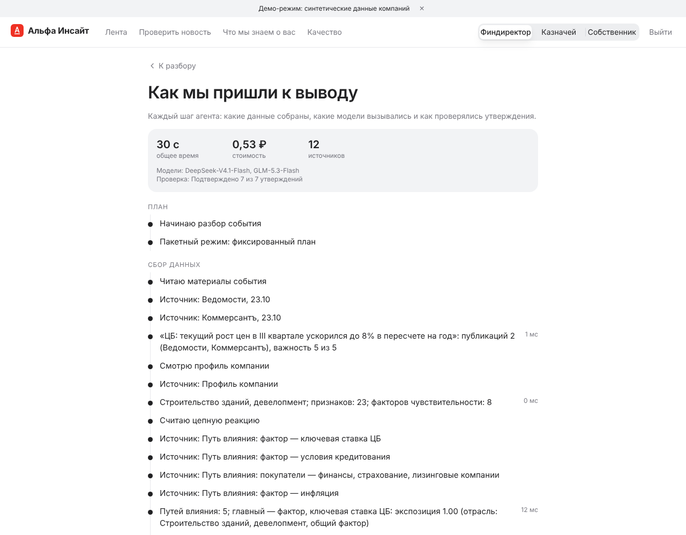
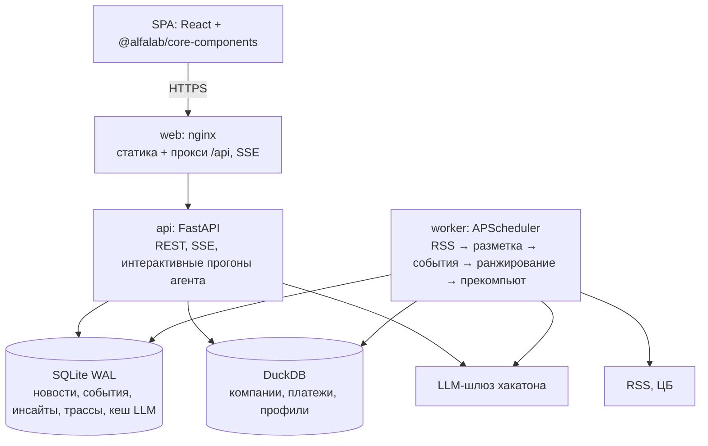

# Альфа Инсайт

Персональная новостная аналитика для крупного бизнеса — клиентов Альфа-Банка с выручкой от 15 млрд ₽.
Сервис превращает поток новостей и аналитику Альфа-Банка в разборы для конкретной компании и конкретного
человека в ней: что произошло, почему это важно именно вам, риски и возможности, что делать и что думает банк.

Проект хакатона «Альфа-Будущее». Демо: *ссылка появится после развёртывания (T6.6)*.



## Что умеет

- **Цепная реакция.** Новость влияет на компанию не только через её отрасль, но и через поставщиков,
  покупателей и макрофакторы (ставка, курс, пошлины). Доли контрагентов считаются по платежам компании,
  поэтому «пошлины на прокат» поднимаются у застройщика, который 34% закупок делает у металлургов.
  Граф пути влияния — на каждой карточке. Второй уровень цепочки — поставщики ваших поставщиков: «руда
  дорожает → металлурги → застройщик» (пунктир в графе).
- **Разбор под роль.** Финансовый директор, казначей и собственник видят разный порядок и разные акценты.
  Утренний брифинг читается меньше чем за минуту.
- **«Проверить новость».** Вставьте ссылку или текст — агент вживую разметит новость, посчитает влияние,
  сам выберет инструменты (аналитика банка, ставка и курсы ЦБ, контрагенты, связанные новости) и напишет
  разбор. Каждый шаг виден в трассе.
- **Слой доверия.** Каждое утверждение помечено: «Факт», «Альфа-Банк» или «Вывод ИИ» — и кликается до
  первоисточника. Перед публикацией разбор проходит 15 детерминированных проверок (ссылки, числа из
  источника, признаки компании) и проверку LLM-судьёй другого семейства. Неподтверждённое скрывается.
- **«Что если».** Ползунки ставки (±2 п. п.) и курса (±10%) на карточке, где влияние идёт через ставку или
  валюту: пересчёт процентных расходов за год по сумме кредита и лизинга и эффекта на каждый 1 млрд ₽ расчётов
  в валюте. Без LLM, с меткой «Вывод ИИ: оценка».
- **Чат по разбору.** «А если ставка снизится до 12%?» — ответ с источниками и теми же метками.
- **Продукты банка без навязывания.** Действие может сопровождаться подходящим продуктом из каталога,
  только если он следует из риска компании.
- **Качество и бюджет.** Страница «Качество»: офлайн-метрики, онлайн-обратная связь, расход LLM по дням,
  очередь экспертной проверки («Утвердить» / «Отклонить») для жюри и администратора.

| Карточка разбора | Как мы пришли к выводу |
|---|---|
|  |  |

## Быстрый старт

### Docker без ключа (`replay`)

```bash
cp .env.example .env
sed -i 's/^LLM_MODE=live /LLM_MODE=replay/' .env
docker compose up -d --build        # init → api + worker → web
open http://localhost:8080
```

Работает на синтетических данных: разметка 630 seed-новостей берётся из кеша `data/seed/llm_cache_demo.jsonl`
бесплатно, ставка и курсы — из снимка. Лента, цепочки влияния, брифинги и профиль доступны сразу. Новые
разборы требуют модель: в `replay` они честно отвечают «сервис аналитики недоступен» (аналитика Альфа-Банка
собирается из PDF кейса, а их публиковать нельзя, поэтому готовые разборы в репозиторий не выгружаются).

### С ключом шлюза (`live`)

```bash
cp .env.example .env    # LLM_BASE_URL, LLM_API_KEY, SESSION_SECRET
docker compose up -d --build
```

Worker собирает новости из RSS, размечает их, ранжирует и заранее готовит разборы для демо-компаний.
PDF аналитики Альфа-Банка кладутся в `data/raw/research/` и разбираются при `init`.

### Разработка

```bash
make setup             # uv sync + npm ci
make data seed         # DuckDB из синтетики, seed-новости
make dev-api dev-web   # API :8000, интерфейс :5173
make check && make test
```

Полная спецификация — [`docs/`](docs/README.md), план работ — [`docs/14-backlog.md`](docs/14-backlog.md),
OpenAPI — `/api/docs` и [`frontend/openapi.json`](frontend/openapi.json).

## Архитектура



- **Конвейер новостей:** RSS → детерминированный префильтр (без LLM) → разметка Gemma (отрасли, факторы,
  направление) → кластеризация в события (одно событие — несколько СМИ) → ранжирование для каждой компании
  и роли. Поиск — SQLite FTS5 по леммам (pymorphy3).
- **Ранжирование:** noisy-OR по путям влияния `own / supply / demand / factor`, веса в
  [`config/ranking.yaml`](config/ranking.yaml), разнообразие ленты (повтор главного пути штрафуется).
- **Агент** — свой, без готовых фреймворков. Два режима с общими инструментами и трассой: `pipeline`
  (фиксированный план, для пакетного расчёта) и `agentic` (модель сама вызывает инструменты, для фичи
  «Проверить новость» и чата). Реестр источников E1…En, проверка, доработка, деградация, финализация.
- **Модели** выбираются по задаче с запасной моделью другого семейства; ответы кешируются; бюджет
  контролируется до каждого вызова.

## Данные

- **Синтетика в репозитории:** 3000 компаний, из них ≈40 целевых и 6 демо-компаний со «сценарием»
  (металлотрейдер, застройщик, автодилер, экспортёр удобрений, перевозчик, топливный оптовик), платежи
  с правдоподобными долями контрагентов по отраслям, продукты банка и ВЭД. Генератор детерминирован:
  `uv run alfa data synth --seed 42`. Названия вымышленные, ИНН с несуществующим кодом региона.
- **Реальные данные кейса** кладутся в `data/raw/` (в `.gitignore`), переключение — `DATA_PROFILE=real`,
  маппинг колонок — [`config/data_mapping.yaml`](config/data_mapping.yaml). Профиль компании: 43 отрасли,
  отрасль контрагента каскадом (ОКВЭД → платежи → название), покрытие смешивает фактические доли с типовыми.
- **Новости:** seed-набор (`data/seed/news.jsonl`, ≈700 новостей за 2 месяца) и живой RSS: Банк России,
  Интерфакс, ТАСС, Коммерсантъ, Ведомости, ПРАЙМ, РБК.

## Модели и бюджет

Только модели шлюза хакатона ([`config/models.yaml`](config/models.yaml), [`docs/04-llm.md`](docs/04-llm.md)):

| Задача | Модель | Запасная |
|---|---|---|
| Разметка новостей | Gemma 4 26B | Qwen3.6-35B (хедж-запрос в фиче B) |
| Черновик разбора, агент, чат | DeepSeek-V4.1-Flash | Kimi K2.6 |
| Проверка (судья) | GLM-5.3-Flash — всегда другое семейство, чем у черновика | Qwen3.6-35B |
| Распознавание сканов PDF | Qwen3-VL-30B | — |
| Офлайн-разметка для оценки | Kimi K2.6 | DeepSeek |

Рассуждения моделей отключены (`reasoning: false`): в 10–30 раз дешевле и быстрее. Фактическая стоимость
по `usage.cost` шлюза, 24.10.2026:

| Операция | ₽ за операцию | В сутки | ₽ в сутки |
|---|---|---|---|
| Разметка новости | 0,025 | 300 | 7,5 |
| Разбор (pipeline: черновик + проверка) | 0,49 | 60 | 29 |
| «Проверить новость» (разметка, агент, проверка) | 0,45 | 40 | 18 |
| Чат | 0,25 | 30 | 7,5 |
| **Итого** | | | **≈ 62 ₽** |

Суточный лимит в коде — 450 ₽ из 500 ₽, последние 150 ₽ зарезервированы под интерактивные запросы;
при приближении к лимиту включается режим экономии. Траты: `uv run alfa llm budget` и страница «Качество».

## Метрики качества

Офлайн-набор: 6 демо-компаний × 10 событий (6 лучших по нашему скору + 4 случайных, чтобы не подыгрывать
себе), оценки 0–3 и направление. Полный отчёт — [`eval/reports/latest.md`](eval/reports/latest.md),
методика — [`docs/12-quality.md`](docs/12-quality.md).

| Вариант ранжирования | nDCG@5 | P@5 | Recall(rel=3)@5 |
|---|---|---|---|
| **Альфа Инсайт: цепная реакция** | **0,82** | 0,63 | 0,89 |
| Без платёжных данных | 0,83 | 0,63 | 0,89 |
| Только своя отрасль | 0,50 | 0,37 | 0,64 |
| Случайный порядок | 0,43 | 0,40 | — |

| Генерация (18 разборов) | Значение |
|---|---|
| Утверждений подтверждено источниками (судья) | 98% |
| Ответы на все 6 вопросов | 100% |
| Опора на данные компании (поставщики, покупатели, продукты, ВЭД, факторы) | 100% |
| Числа сверены с источниками | 100% |
| Разборы с найденными судьёй противоречиями | 22% |
| Стоимость разбора | 0,49 ₽ |
| «Проверить новость»: свежие ссылки | 8 из 8 разобраны, p50 ≈ 21 с (раньше 10 ссылок: 8 разобраны, 2 — сайт не отдал страницу, p50 22,6 с) |

Честные оговорки: оценки пока — предразметка моделью Kimi (другое семейство, чем у разметки новостей),
ручная проверка командой — `alfa eval label`. Вариант «без платёжных данных» на этом пуле не хуже: в нём
преобладают макрособытия (ставка, курс), где влияние идёт через фактор; платежи меняют скор до 0,13, но не
порядок. Противоречия — в основном разные трактовки решения по ставке в источниках; судья их находит, и они
видны в трассе.

## Безопасность

- Ключ шлюза только на сервере; в браузер, логи и git не попадает. Подписанная cookie-сессия с компанией:
  инструменты агента берут компанию из сервера, а не из аргументов модели.
- «Проверить новость» загружает URL безопасным загрузчиком: только http/https, проверка IP после DNS и на
  каждом редиректе (без частных и служебных адресов), лимиты размера и времени.
- Тексты новостей, PDF и ввод пользователя — недоверенные: оборачиваются в разметку, проходят детектор
  инъекций, модель не может вызвать инструмент с чужой компанией или добавить посторонние ссылки.
- Ограничение частоты запросов, бюджет на прогон и на сутки, CSP и заголовки безопасности в nginx.
  Подробно — [`docs/11-security.md`](docs/11-security.md).

## Ограничения и допущения

- Данные компаний в репозитории синтетические; на реальных CSV кейса система собирается той же командой.
- «Проверить новость» укладывается примерно в 18–28 с, p50 ≈ 21 с (три последовательных вызова моделей); часть сайтов
  (например, ТАСС) не отдаёт страницу — тогда предлагается вставить текст.
- Аналитика Альфа-Банка подключается из PDF кейса, которые не публикуются; без них позиция банка в разборе
  помечается как «нет данных».
- Шесть вопросов кейса сопоставлены с блоками разбора по допущению (ADR-22 в
  [`docs/01-review.md`](docs/01-review.md)).

## Лицензия

MIT — [`LICENSE`](LICENSE). Сторонние компоненты и данные — [`THIRD_PARTY_NOTICES.md`](THIRD_PARTY_NOTICES.md).

## Команда

nedreyner — хакатон «Альфа-Будущее», 2026.
