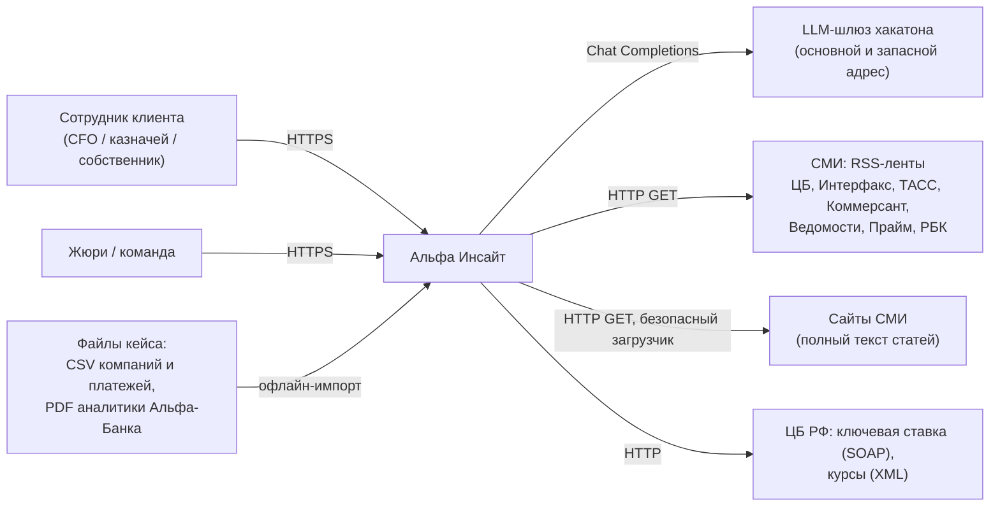
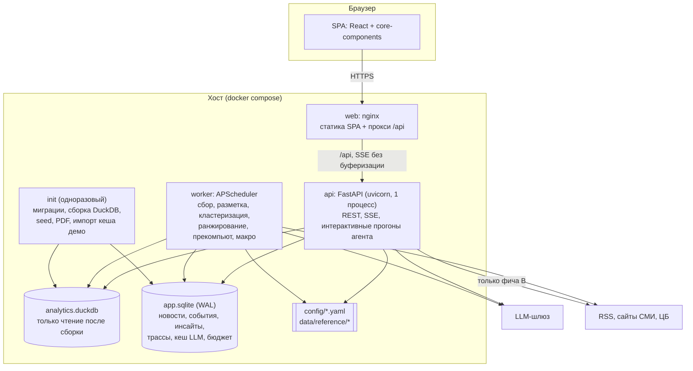
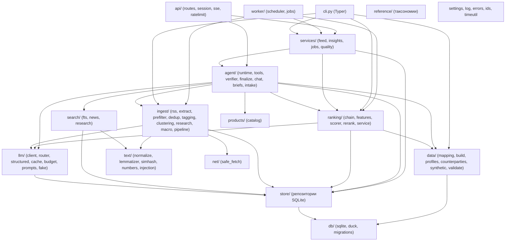
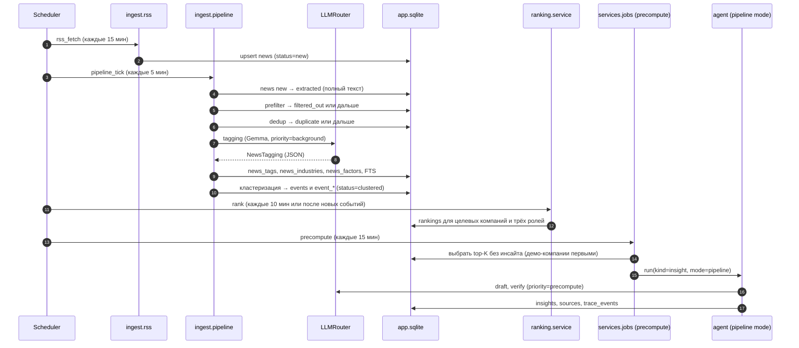
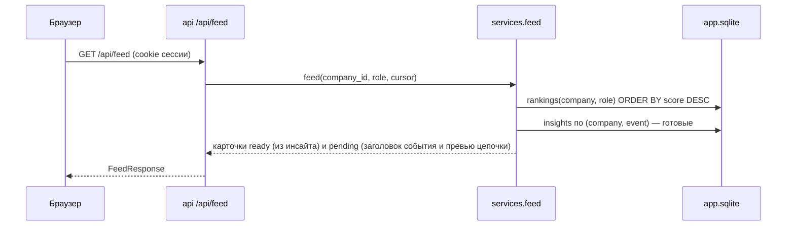
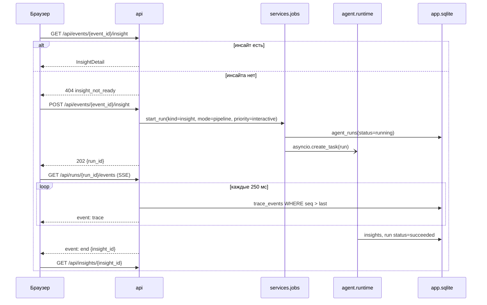
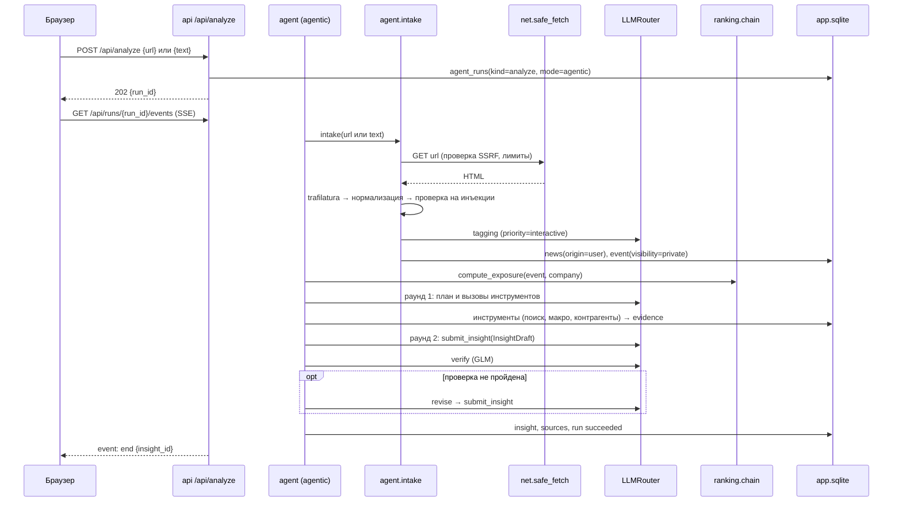
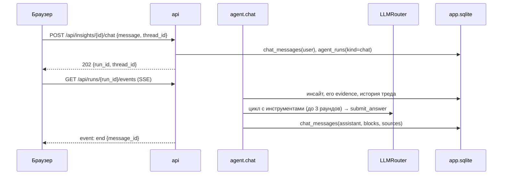

# 02. Архитектура

## 1. Назначение и пользовательские сценарии

Система ежедневно собирает новости и аналитику Альфа-Банка. Для каждой целевой компании она находит события, которые на неё влияют, и объясняет влияние: через её отрасль, её поставщиков и покупателей (граф платежей) и её макроэкспозицию (кредиты, лизинг, ВЭД).

| ID | Сценарий | Кто | Экран |
|---|---|---|---|
| S1 | Посмотреть, что сегодня важно для моей компании | Сотрудник клиента | Главная «Альфа-Бизнес» → виджет, Лента |
| S2 | Разобрать одно событие: что, почему мне, риски, возможности, действия, позиция банка, источники | Сотрудник клиента | Карточка инсайта |
| S3 | Понять, как ИИ пришёл к выводу | Сотрудник, жюри | «Как мы пришли к выводу» (трасса) |
| S4 | Проверить любую новость по ссылке или тексту | Сотрудник, жюри | «Проверить новость» |
| S5 | Задать уточняющий вопрос по инсайту | Сотрудник | Чат «Спросить аналитика» |
| S6 | Получить 3 главных события под свою роль | Финдиректор, казначей, собственник | Виджет на главной, переключатель роли |
| S7 | Увидеть и поправить, что сервис знает о компании | Сотрудник | «Что мы о вас знаем» |
| S8 | Оценить качество и стоимость работы системы | Жюри, команда | «Качество» |

## 2. Контекст (C4, уровень 1)



## 3. Контейнеры (C4, уровень 2)



| Контейнер | Ответственность | Не делает |
|---|---|---|
| `web` | Отдаёт собранный SPA; проксирует `/api/*` на `api:8000` с отключённой буферизацией (нужно для SSE) | Никакой логики |
| `api` | REST и SSE; сессии; лента и карточки из готовых данных; **интерактивные прогоны** (фича B, генерация по запросу, чат) как asyncio-задачи внутри процесса; лимиты частоты | Не ходит в RSS по расписанию, не строит DuckDB |
| `worker` | Задачи по расписанию: RSS → конвейер → ранжирование → **прекомпьют** инсайтов (режим `pipeline`) → обновление макро | Не обслуживает HTTP |
| `init` | Однократно при старте: миграции SQLite, `alfa data build` (если DuckDB нет или изменились исходники), загрузка seed, разбор PDF (если не делался), импорт кеша демо | Завершается с кодом 0; `api` и `worker` ждут его через `service_completed_successfully` |

## 4. Компоненты бэкенда (C4, уровень 3) и правила зависимостей



**Правила (проверяются ревью; по желанию — `import-linter`):**

1. Нижние слои не импортируют верхние: `store`, `data`, `llm`, `text`, `net` и `reference` ничего не знают про `agent`, `services`, `api` и `worker`.
2. SQL к SQLite пишется **только** в `store/`, к DuckDB — **только** в `data/`. Остальные модули работают с Pydantic-моделями и dataclass.
3. В `openai` ходит **только** `llm/client.py`. Всё остальное идёт через `LLMRouter`.
4. `api/` содержит тонкие роуты: валидация входа, вызов сервиса, преобразование в DTO. Бизнес-логики там нет.
5. `agent/intake.py` переиспользует функции конвейера из `ingest/`: извлечение, нормализацию и разметку. Второй реализации нет.
6. Всё, что зависит от конфигурации, получает её параметром или через `get_settings()`. На уровне модуля конфиг не читается.

## 5. Ключевые потоки

### 5.1 Фоновый конвейер (worker)



### 5.2 Лента



Карточка в статусе `pending` показывает заголовок события и **детерминированное превью цепочки** из `rankings.chain_json`, без LLM. Полный инсайт генерируется при открытии (5.3) или прекомпьютом.

### 5.3 Открытие карточки и генерация по запросу



### 5.4 Фича B: «Проверить любую новость»



Если URL уже есть в базе (пришёл из RSS), intake переиспользует новость и её событие: разметки нет, путь быстрее.

### 5.5 Чат «Спросить аналитика»



### 5.6 Главная и брифинг роли

`GET /api/brief` берёт три верхних готовых инсайта из `rankings` для `(company, role)` и для каждого выбирает действие с `owner_role = role`. Брифинг детерминированный, LLM не вызывается.

### 5.7 Обратная связь и правки профиля

- `POST /api/insights/{id}/feedback` → `feedback`. Агрегаты идут на страницу «Качество» и в еженедельный пересчёт весов (`12-quality.md` §7).
- `PUT /api/me/profile/overrides` → `profile_overrides`. Затем `ProfileStore.invalidate(company)` и синхронный пересчёт `rankings` для компании (миллисекунды). Версия профиля меняется, поэтому старые инсайты помечаются как устаревшие (`profile_version` в инсайте ≠ текущей) и при открытии пересчитываются.

## 6. Владение данными

| Хранилище / таблица | Пишет | Читает |
|---|---|---|
| `analytics.duckdb`: `companies`, `company_products`, `company_ved`, `payments` | `init` (`data.build`) | `data.*` |
| `analytics.duckdb`: `counterparty_industry`, `flows_by_industry`, `top_counterparties`, `coverage`, `company_factors`, `profiles` | `init` (`data.build`) | `data.profiles`, `data.counterparties` |
| `news`, `news_tags`, `news_industries`, `news_factors`, `news_geo`, `news_entities`, `news_fts` | `worker` (конвейер), `api` (intake фичи B) | `search`, `ranking`, `agent`, `api` |
| `events`, `event_industries`, `event_factors`, `events_fts` | `worker` (кластеризация), `api` (intake) | `ranking`, `agent`, `api` |
| `research_docs`, `research_chunks`, `research_items`, `research_fts` | `init` / CLI (`research ingest`) | `search.research`, `agent` |
| `macro_series` | `worker` (`macro_refresh`), `init` (снимок) | `agent` (`get_macro`), `api` (`/macro`) |
| `rankings` | `worker` (`rank`), `api` (после правки профиля, intake) | `services.feed`, `briefs`, `precompute` |
| `agent_runs`, `trace_events` | тот процесс, где идёт прогон | `api` (SSE, трасса, качество) |
| `insights`, `sources`, `insight_sources` | `agent.finalize` | `api` |
| `chat_messages` | `api`, `agent.chat` | `api` |
| `feedback`, `ui_events`, `leads`, `profile_overrides` | `api` | `api`, `quality`, `data.profiles` |
| `llm_cache`, `llm_calls` | `llm` | `llm`, `quality`, CLI |
| `kv` | все (водяные знаки, служебное) | все |

## 7. Процессы, конкурентный доступ, идемпотентность

**Процессы.** В `api` один процесс uvicorn (асинхронный). Несколько процессов не нужны и сломали бы ограничение параллельных прогонов в памяти. В `worker` один процесс; у всех задач `max_instances=1`, `coalesce=True`.

**Интерактивные прогоны** запускаются в `api` через `asyncio.create_task`. Глобальный семафор ограничивает одновременные прогоны (`AGENT_MAX_CONCURRENT_RUNS=4`), лишние запросы получают `429 busy`. На каждый прогон действует жёсткий таймаут (`AGENT_RUN_TIMEOUT_S=60` для insight и analyze, 30 для chat).

**SQLite:**
- PRAGMA при каждом подключении: `journal_mode=WAL`, `synchronous=NORMAL`, `foreign_keys=ON`, `busy_timeout=5000`.
- Короткие транзакции через `with db.tx():`. LLM-вызовы внутри транзакции запрещены.
- В асинхронном коде тяжёлые запросы (больше ~20 мс: FTS, агрегаты качества) выполняются через `asyncio.to_thread`.

**DuckDB.** Файл `analytics.duckdb` собирается только командой `alfa data build`: в `init` или вручную при остановленных `api` и `worker`. Сборка идёт во временный файл, затем атомарный `os.replace`. `api` и `worker` открывают его с `read_only=True`. Правки профиля в DuckDB не пишутся (ADR-14).

**SSE.** Эндпоинт `GET /api/runs/{id}/events` опрашивает `trace_events` раз в 250 мс начиная с `Last-Event-ID`. Поэтому SSE одинаково работает для прогонов в `api` и в `worker`, переживает переподключение и отдаёт историю (ADR-15).

**Идемпотентность:**
- `news.url_hash` уникален (повторный RSS не создаёт дублей); стадии конвейера переводят статус только вперёд.
- `insights` уникальны по `(company_id, event_id, prompt_version, profile_version)`. Повторный запрос генерации, пока прогон по этой паре идёт, возвращает существующий `run_id`.
- В LLM-кеше ключ — хеш канонизированного запроса (`04-llm.md` §6).

**Восстановление.** При старте `api` и `worker` прогоны в статусе `running` старше `2 × AGENT_RUN_TIMEOUT_S` переводятся в `failed` с ошибкой `interrupted`.

## 8. Режимы деградации

| Ситуация | Поведение системы | Что видит пользователь |
|---|---|---|
| Основной адрес шлюза недоступен | `llm.client` повторяет запрос на `LLM_BASE_URL_FALLBACK` | Ничего |
| Модель возвращает ошибки или таймауты | Ретраи с экспоненциальной задержкой (2 попытки), затем следующая модель из цепочки задачи | Ничего, в трассе отметка «запасная модель» |
| Шлюз недоступен совсем | Готовые инсайты, лента и брифинг работают; новые прогоны завершаются ошибкой `llm_unavailable` | Баннер «Аналитика обновляется, показаны последние данные»; у фичи B понятная ошибка |
| Остаток бюджета ниже резерва | Фоновые задачи (разметка, прекомпьют) на паузе до следующих суток | Ничего |
| Бюджет исчерпан | Новые вызовы блокируются (`budget_exhausted`), работает только кеш (`replay`) | Баннер «Режим экономии», фича B недоступна |
| Модель не поддерживает tools | Прогон идёт в режиме `pipeline` (фиксированный план) | Трасса без динамического плана |
| RSS-источник недоступен | Источник пропускается, ошибка в `kv:source_status:<id>`; при недоступности всех — только seed | Ничего |
| ЦБ недоступен | Последние значения из `macro_series` или снимок `data/seed/macro.json` | Дата значения рядом с цифрой |
| У компании нет платёжных данных | Типовые доли отрасли, `coverage=0` | «Оценка по отраслевой модели: нет данных о ваших платежах» |
| Проверка не пройдена после доработки | Неподтверждённые утверждения удаляются; если пустеет обязательный блок — статус `needs_review` | Плашка «Требует проверки аналитиком», уверенность «низкая» |
| Нет PDF-аналитики по теме | `bank_view.available=false`, `alignment=no_data` | «У аналитиков Альфа-Банка нет публикаций по теме» |

## 9. Конфигурация

Секреты и параметры окружения задаются через переменные окружения (`alfa_insight/settings.py`, pydantic-settings, файл `.env`). Предметные настройки лежат в YAML внутри репозитория.

| Источник | Содержимое |
|---|---|
| `.env` | `LLM_BASE_URL`, `LLM_BASE_URL_FALLBACK`, `LLM_API_KEY`, `LLM_MODE`, бюджеты, `SESSION_SECRET`, `ADMIN_TOKEN`, `JURY_CODE`, `DEMO_MODE`, `DATA_PROFILE`, `DATA_DIR`, флаги и интервалы worker (полный список — `13-deploy-demo.md` §2) |
| `config/models.yaml` | Модели, цены, возможности, цепочки моделей по задачам (`04-llm.md` §2) |
| `config/sources.yaml` | RSS-источники, рубрики, доверие (`06-ingestion-search.md` §2) |
| `config/data_mapping.yaml` | Маппинг колонок CSV (`03-data.md` §3) |
| `config/ranking.yaml` | Веса, роли, пороги (`07-ranking.md` §6) |
| `config/products.yaml` | Каталог продуктов и правила (`08-agent.md` §15) |
| `config/demo.yaml` | Демо-компании, их истории, параметры прекомпьюта (`03-data.md` §8.3) |
| `data/reference/*.yaml` | Отрасли, факторы, типы событий, эффекты, страны (`03-data.md` §5) |

Все YAML при загрузке проверяются Pydantic-моделями (`reference/models.py`, `config_models.py`). Ошибка в конфиге останавливает старт с понятным сообщением.

## 10. Наблюдаемость

- **Логи:** structlog в JSON. Обязательные поля: `ts`, `level`, `event`, `component`; по контексту `run_id`, `company_id`, `task`, `model`. ИНН и названия реальных компаний в логи не пишутся, только `company_id`.
- **Трасса прогона** (`trace_events`) показывается пользователю. Это и журнал аудита вызовов инструментов (`11-security.md`).
- **Учёт LLM** (`llm_calls`): каждый вызов с токенами, стоимостью, задержкой, признаком кеша и статусом.
- **Состояние:** `GET /api/health` (процесс жив) и `GET /api/ready` (открыты SQLite и DuckDB, профили загружены, миграции применены, доступность шлюза по последнему успешному вызову).
- **Метрики качества:** `GET /api/quality` (`12-quality.md` §6).

## 11. Структура репозитория

```
alfa-hackathon-2026/
├── CLAUDE.md
├── README.md                         # T6.5
├── THIRD_PARTY_NOTICES.md            # T6.5
├── LICENSE                           # MIT (решение команды)
├── Makefile
├── docker-compose.yml
├── .env.example
├── .gitignore                        # data/raw, data/runtime, .env, node_modules, __pycache__, dist
├── .github/workflows/ci.yml
├── config/
│   ├── models.yaml
│   ├── sources.yaml
│   ├── data_mapping.yaml             # профиль real (заполняется в T1.6)
│   ├── data_mapping.synthetic.yaml   # профиль synthetic
│   ├── ranking.yaml
│   ├── products.yaml
│   └── demo.yaml
├── data/
│   ├── reference/
│   │   ├── industries.yaml
│   │   ├── factors.yaml
│   │   ├── event_types.yaml
│   │   ├── effects.yaml
│   │   ├── countries.yaml
│   │   ├── prefilter_lexicon.yaml
│   │   ├── injection_patterns.yaml
│   │   └── stopwords_ru.txt
│   ├── synthetic/                    # companies.csv, products.csv, ved.csv, payments.csv
│   ├── seed/
│   │   ├── news.jsonl
│   │   ├── macro.json
│   │   └── llm_cache_demo.jsonl
│   ├── raw/                          # .gitignore
│   └── runtime/                      # .gitignore
├── backend/
│   ├── pyproject.toml
│   ├── uv.lock
│   ├── Dockerfile
│   ├── alfa_insight/
│   │   ├── __init__.py               # __version__
│   │   ├── settings.py
│   │   ├── appctx.py                 # AppContext + build_context(settings): общий контейнер зависимостей
│   │   ├── config_models.py          # Pydantic-модели YAML-конфигов
│   │   ├── log.py
│   │   ├── errors.py
│   │   ├── ids.py
│   │   ├── timeutil.py
│   │   ├── cli.py
│   │   ├── reference/  (models.py, taxonomy.py)
│   │   ├── db/         (sqlite.py, duck.py, migrations/0001_init.sql)
│   │   ├── store/      (news.py, events.py, research.py, macro.py, rankings.py, runs.py,
│   │   │                insights.py, chat.py, feedback.py, profiles.py, llm.py, kv.py)
│   │   ├── data/       (mapping.py, build.py, build_sql.py, factors.py, profiles.py,
│   │   │                counterparties.py, synthetic.py, validate.py, models.py)
│   │   ├── text/       (normalize.py, lemmatizer.py, simhash.py, numbers.py, injection.py)
│   │   ├── net/        (safe_fetch.py)
│   │   ├── llm/        (types.py, client.py, router.py, structured.py, cache.py, budget.py,
│   │   │                prompts.py, fake.py, probe.py)
│   │   ├── prompts/    (*.j2)
│   │   ├── ingest/     (schemas.py, sources.py, rss.py, extract.py, prefilter.py, dedup.py, tagging.py,
│   │   │                clustering.py, pipeline.py, seed.py, macro.py,
│   │   │                research/ (parse.py, chunk.py, extract.py, vision.py, pipeline.py))
│   │   ├── search/     (fts.py, news.py, research.py)
│   │   ├── ranking/    (effects.py, chain.py, features.py, scorer.py, rerank.py, service.py)
│   │   ├── products/   (catalog.py)
│   │   ├── agent/      (schemas.py, evidence.py, context.py, tools.py, trace.py, runtime.py,
│   │   │                pipeline_mode.py, agentic_mode.py, verifier.py, finalize.py,
│   │   │                intake.py, chat.py, briefs.py)
│   │   ├── services/   (feed.py, insights.py, jobs.py, quality.py)
│   │   ├── api/        (app.py, deps.py, session.py, errors.py, sse.py, ratelimit.py,
│   │   │                schemas.py, routes/*.py)
│   │   ├── worker/     (main.py, jobs.py)
│   │   └── eval/       (labels.py, ranking_eval.py, grounding_eval.py, completeness.py, report.py)
│   └── tests/
│       ├── conftest.py               # tmp DATA_DIR, LLM_MODE=fake, мини-датасет
│       ├── fixtures/                 # mini CSV, RSS XML, HTML, ответы LLM
│       ├── unit/ ...
│       └── integration/ ...
├── frontend/
│   ├── package.json, package-lock.json, vite.config.ts, tsconfig.json, eslint.config.js
│   ├── index.html, Dockerfile, nginx.conf
│   ├── openapi.json                  # выгружается make openapi
│   └── src/ (см. 10-frontend.md §2)
├── eval/
│   ├── labels.csv
│   └── reports/latest.json
└── docs/
```
