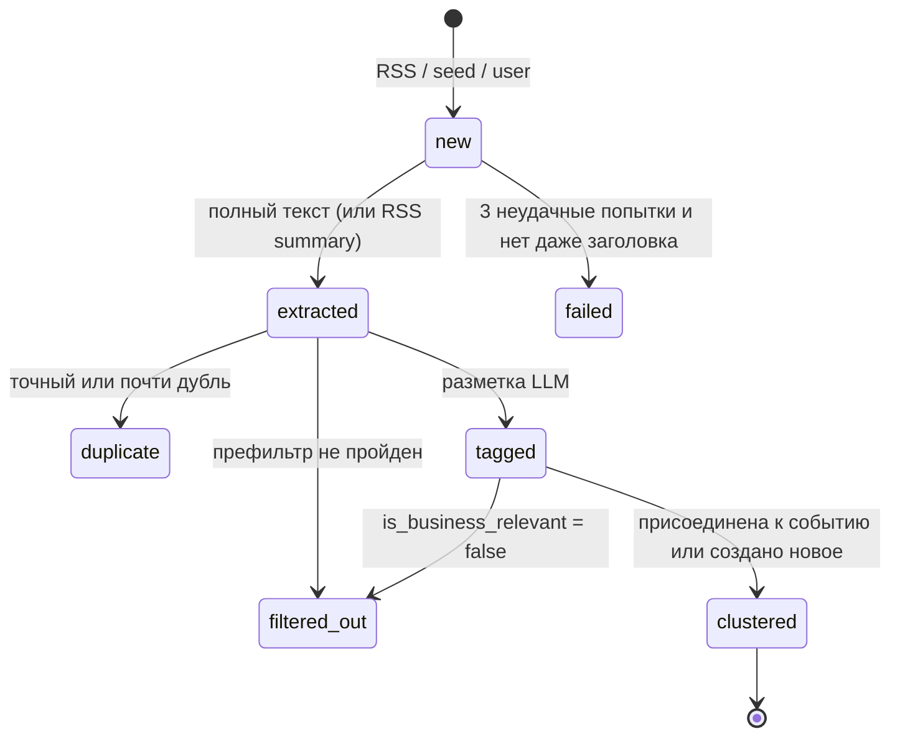

# 06. Сбор новостей, аналитика банка, макро, поиск

## 1. Конвейер новостей: стадии и статусы



Каждая стадия — идемпотентная функция над пачкой новостей в нужном статусе (`ingest/pipeline.py`). Статус меняется только вперёд. Ошибка стадии увеличивает `news.attempts`. После 3 попыток извлечения новость идёт дальше с `rss_summary`, после 3 попыток разметки получает `failed`.

```python
class PipelineStats(BaseModel):
    fetched: int = 0; extracted: int = 0; filtered_out: int = 0; duplicates: int = 0
    tagged: int = 0; clustered: int = 0; failed: int = 0; cost_rub: float = 0.0

async def pipeline_tick(ctx: AppContext, *, max_extract: int = 50, max_tag: int = 40,
                        max_cost_rub: float | None = None) -> PipelineStats: ...
```

`AppContext` (`alfa_insight/appctx.py`) — контейнер зависимостей: settings, `SqliteDB`, `DuckReader`, `Taxonomy`, `LLMRouter`, `ProfileStore`, `PromptLoader`, `ProductCatalog`, конфиги. Собирается `build_context(settings)` один раз в `api`, `worker` и `cli`.

## 2. Источники (`config/sources.yaml`)

```yaml
version: 1
user_agent: "AlfaInsightBot/0.1 (+https://github.com/nedreyner/alfa-hackathon-2026)"
defaults: {timeout_s: 15, max_items: 100, full_text: true, enabled: true, geo: any}
sources:
  - {id: cbr_events, publisher: Банк России, url: "https://www.cbr.ru/rss/eventrss", trust: 1.0, kind: official}
  - {id: cbr_press,  publisher: Банк России, url: "https://www.cbr.ru/rss/RssPress",  trust: 1.0, kind: official}
  - {id: interfax,   publisher: Интерфакс,   url: "https://www.interfax.ru/rss",      trust: 0.9, kind: agency,
     categories_allow: ["Экономика"], categories_soft: true}
  - {id: tass,       publisher: ТАСС,        url: "https://tass.ru/rss/v2.xml",       trust: 0.9, kind: agency,
     categories_allow: ["Экономика и бизнес"]}
  - {id: kommersant, publisher: Коммерсантъ, url: "https://www.kommersant.ru/rss/section-economics.xml", trust: 0.9, kind: media}
  - {id: vedomosti,  publisher: Ведомости,   url: "https://www.vedomosti.ru/rss/news", trust: 0.9, kind: media,
     categories_allow_prefix: ["Бизнес", "Экономика", "Финансы", "Инвестиции", "Технологии"]}
  - {id: prime,      publisher: ПРАЙМ,       url: "https://1prime.ru/export/rss2/index.xml", trust: 0.85, kind: agency}
  - {id: rbc,        publisher: РБК,         url: "https://rssexport.rbc.ru/rbcnews/news/30/full.rss", trust: 0.9, kind: media,
     geo: ru}       # из зарубежной сети сбрасывает соединение (проверено 22.10.2026)
```

- `categories_allow` — новость проходит фильтр рубрики, если хотя бы одна её рубрика есть в списке. `categories_allow_prefix` — то же по префиксу. `categories_soft: true` — у Интерфакса в общей ленте экономических новостей мало: несовпадение рубрики снижает балл префильтра, но не отсекает новость.
- `geo: ru` — источник опрашивается, только если `INGEST_GEO=ru` (хостинг в РФ), иначе пропускается без ошибки.
- `trust` — доверие к источнику (0..1), используется в ранжировании. Для `user` — 0.5, для `seed` — `trust` исходного источника.
- Проверенные 22.10.2026 факты: у ЦБ и Ведомостей пустой `description` в RSS, поэтому полный текст обязателен. У Интерфакса `/rss.asp` даёт редирект на `/rss`. У Коммерсанта путь `/RSS/` даёт редирект на `/rss/`. В конфиге сразу конечные адреса.

## 3. Сбор RSS (`ingest/rss.py`)

1. Для каждого включённого источника — `httpx.AsyncClient` (UA из конфига, `follow_redirects=True`, `max_redirects=3`, таймаут из конфига, лимит тела 5 МБ). Условные заголовки `If-None-Match` и `If-Modified-Since` берутся из `kv:rss_etag:<id>`. Ответ 304 означает «нового нет».
2. `feedparser.parse(content_bytes)`. Для каждой записи:
   - `url` = `normalize_url(entry.link)`: схема и хост в нижнем регистре; убрать `utm_*`, `from`, `ref`, `yclid`, `gclid`, фрагмент `#…`, хвостовой `/` (кроме корня);
   - `external_id` = `entry.id` или `entry.guid`, иначе `url`;
   - `title`, `rss_summary` — без HTML (`html.unescape` и удаление тегов регуляркой), через `normalize_text`;
   - `published_at` = `published_parsed` или `updated_parsed` → UTC; нет даты → `fetched_at`;
   - `rss_categories` = `[t.term for t in entry.tags]`.
3. Пропустить записи старше `RSS_MAX_AGE_DAYS` (7).
4. `INSERT OR IGNORE` по `url_hash` и уникальному `(source_id, external_id)` со `status='new'`.
5. Состояние источника — в `kv:source_status:<id>` = `{ok, last_success_at, last_error, items_total, items_new}`. Падение одного источника не останавливает остальные.

## 4. Полный текст (`ingest/extract.py`, `net/safe_fetch.py`)

- Обрабатываются новости `status='new'` с `full_text=true` у источника, пачкой до `max_extract`. Конкурентность — 4, но не больше 1 запроса в секунду на хост (простой rate limiter на `asyncio`).
- `safe_fetch(url, max_bytes=2_000_000, timeout_s=10, max_redirects=3)` → `FetchResult(url_final, status, content_type, text)`. Требования к безопасности — `11-security.md` §3. Допустимые типы содержимого: `text/html`, `application/xhtml+xml`, `text/plain`.
- `trafilatura.extract(html, url=url, include_comments=False, include_tables=True, favor_precision=True, deduplicate=True, output_format="txt")`.
- Результат короче 300 символов или `None` → `body = rss_summary`, `body_source='rss_summary'`. Пустой summary → `body = title`.
- `normalize_text(body)`: удалить строки-шаблоны («Читайте также», «Подписывайтесь», «Фото:», «Реклама», …) по списку из `prefilter_lexicon.yaml: boilerplate`; схлопнуть пробелы; обрезать до 20 000 символов.
- После извлечения — `content_hash = sha1(lower(title) + "\n" + lower(body[:5000]))`, статус `extracted`.
- Детектор инъекций (`text/injection.py`, `11-security.md` §4) заполняет `news.injection_flags`.

## 5. Нормализация и лемматизация (`text/normalize.py`, `text/lemmatizer.py`)

- `normalize_text(s)`: `html.unescape`; Unicode NFC; `\xa0` и узкие пробелы → обычный пробел; удаление невидимых символов (тот же набор, что в `sanitize_untrusted`); схлопывание пробелов и пустых строк.
- `tokenize(s)`: нижний регистр, `ё → е`, регулярка `[a-zа-я0-9]+(?:-[a-zа-я0-9]+)*`.
- `lemmatize(s) -> list[str]`: токены → `pymorphy3.MorphAnalyzer(lang="ru").parse(t)[0].normal_form` для кириллицы (кеш `functools.lru_cache(maxsize=200_000)`), латиница и числа как есть, стоп-слова (`stopwords_ru.txt`) и токены длиной 1 выбрасываются.
- `lemmas_str(s) -> str` — леммы через пробел (для FTS).
- Анализатор создаётся один раз на процесс: загрузка словаря занимает около 1 с.

## 6. Префильтр (`ingest/prefilter.py`, `data/reference/prefilter_lexicon.yaml`)

```yaml
version: 1
econ: [ставка, пошлина, экспорт, импорт, санкция, налог, цена, тариф, рубль, курс, инфляция, кредит, ипотека,
       выручка, прибыль, убыток, производство, поставка, дефицит, рынок, биржа, отрасль, инвестиция, субсидия,
       госзакупка, логистика, перевозка, банк, лизинг, валюта, юань, доллар, евро, нефть, газ, металл, зерно,
       утильсбор, квота, запрет, регулирование, минфин, минэкономразвития, цб, правительство, бизнес, компания,
       застройщик, ритейл, дистрибьютор, маркировка, акциз, демпфер, экспортер, импортер, спрос, предложение]
negative: [футбол, хоккей, матч, чемпионат, турнир, сериал, фильм, концерт, певец, актер, шоу, гороскоп,
           дтп, убийство, погода, землетрясение]
negative_exceptions: {погода: [урожай, посев, энергопотребление], землетрясение: [добыча, завод, порт]}
boilerplate: ["Читайте также", "Подписывайтесь", "Фото:", "Реклама", "Новости партнеров"]
```

Все слова в словаре — уже леммы. Балл:

```
score =  2  если рубрика разрешена или у источника нет фильтра рубрик
      − 3  если у новости есть рубрики, ни одна не разрешена и categories_soft = false
      − 1  если то же, но categories_soft = true
      + min(4, число различных лемм из econ)
      + min(2, число отраслей, у которых совпало хотя бы одно keyword)
      − min(6, 3 × число лемм из negative без исключений)
```

Новость проходит, если `score ≥ PREFILTER_MIN_SCORE` (по умолчанию 3) **или** `trust = 1.0` (официальные источники). Балл пишется в `news.prefilter_score`. Не прошедшие получают статус `filtered_out` и в LLM не уходят.

## 7. Дедупликация (`ingest/dedup.py`, `text/simhash.py`)

1. **Точный дубль:** тот же `content_hash` у недубликата за последние 7 дней → `status='duplicate'`, `duplicate_of=<id>`.
2. **Почти дубль:** simhash64 по шинглам из 3 подряд идущих лемм **и отдельным леммам** (заголовок + первые 3000 символов текста). Вес признака — частота, хеш — `blake2b(digest_size=8)`. Только шинглы на заметках в 100–300 лемм дают 4–10 бит разницы на перепубликации с другим вступлением; с леммами — 2 бита, у разных новостей на одну тему — больше 20. Расстояние Хэмминга ≤ `SIMHASH_MAX_DISTANCE` (3) с новостью за последние 72 часа → дубль.
3. Для сравнения в начале каждого тика загружается индекс недавних simhash: `SELECT id, simhash FROM news WHERE published_at > now−72h AND status IN ('extracted','tagged','clustered')`. Перебор линейный: за 72 часа набирается не больше нескольких тысяч записей.
4. В SQLite simhash хранится как знаковый int64: `v - 2**64 if v >= 2**63 else v`.

Дубли разных изданий (переписанный текст) сюда не попадают: их склеивает кластеризация (§9).

## 8. Разметка (`ingest/tagging.py`)

### 8.1 Схема ответа

```python
# ingest/schemas.py
Effect = Literal["prices_up", "prices_down", "demand_up", "demand_down", "supply_down", "supply_up",
                 "costs_up", "costs_down", "regulation_tighter", "support_measures"]

class IndustryImpactTag(BaseModel):
    industry_id: str
    effect: Effect
    impact: Literal[1, 2, 3]
    confidence: Literal[1, 2, 3]
    rationale: str = Field(max_length=200)

class FactorImpactTag(BaseModel):
    factor_id: str
    direction: Literal["up", "down"]
    impact: Literal[1, 2, 3]
    confidence: Literal[1, 2, 3]
    rationale: str = Field(max_length=200)

class EntityTag(BaseModel):
    kind: Literal["company", "gov", "person", "country", "org"]
    name: str = Field(max_length=120)

class KeyNumber(BaseModel):
    value: str = Field(max_length=40)
    unit: str | None = Field(default=None, max_length=30)
    context: str = Field(max_length=120)

class NewsTagging(BaseModel):
    is_business_relevant: bool
    summary: str = Field(max_length=400)
    event_type: str
    importance: Literal[1, 2, 3, 4, 5]
    horizon: Literal["days", "weeks", "months", "quarters"]
    industries: list[IndustryImpactTag] = Field(default_factory=list, max_length=6)
    factors: list[FactorImpactTag] = Field(default_factory=list, max_length=5)
    geo: list[str] = Field(default_factory=list, max_length=8)
    entities: list[EntityTag] = Field(default_factory=list, max_length=8)
    key_numbers: list[KeyNumber] = Field(default_factory=list, max_length=6)
    injection_suspected: bool = False
```

### 8.2 Процесс

1. Взять до `max_tag` новостей `status='extracted'` (свежие первыми). Конкурентность 4.
2. `router.structured(task="tagging", schema=NewsTagging, prompt_version=f"tagging_v1+tx{taxonomy.version}", priority="background")`. Для intake фичи B — `task="tagging_interactive"`.
3. **Постобработка:**
   - неизвестные `industry_id`, `factor_id`, `event_type` отбросить (`event_type` → `other`) и записать предупреждение в лог;
   - `geo` оставить только валидные ISO2 или `RU-XXX`;
   - пары `(industry_id, effect)` дедуплицировать с максимальным `impact`;
   - перевести шкалы для хранения: `impact` и `confidence` 1/2/3 → 0.33/0.67/1.0, `direction` `up`/`down` → `+1`/`−1`.
4. Записать в одной транзакции `news_tags`, `news_industries`, `news_factors`, `news_geo`, `news_entities` и `news_fts(rowid=id, title_lemmas, body_lemmas)`.
5. `is_business_relevant=false` → `status='filtered_out'` (строка разметки остаётся для аудита), иначе `status='tagged'`.
6. `injection_suspected` модели или непустые `injection_flags` детектора → флаг передаётся событию при кластеризации.
7. Остановиться, если суммарная стоимость тика превысила `max_cost_rub`, или по `BudgetExceeded`. Необработанные новости остаются `extracted` до следующего тика.

## 9. Кластеризация в события (`ingest/clustering.py`)

В таблицу `events` добавлена колонка `key_lemmas TEXT NOT NULL DEFAULT '[]'` (`03-data.md` §9) — топ-40 лемм события.

Для каждой новости `status='tagged'` в порядке `published_at`:

1. **Ключевые леммы новости:** заголовок (вес 2) + `summary` разметки (вес 1), без стоп-слов. Берутся топ-30 по весу.
2. **Кандидаты:** публичные события, у которых `last_seen_at ≥ published_at − 72ч` и выполнено хотя бы одно: тот же `event_type`; есть общий `industry_id`; есть общий `factor_id`.
3. **Сходство** — Жаккар ключевых лемм новости и `events.key_lemmas`. Если сходство с лучшим кандидатом не ниже `CLUSTER_SIM_THRESHOLD` (0.30) **и** (Жаккар заголовков ≥ 0.15 **или** есть общая сущность из `news_entities`), новость присоединяется к событию.
4. **Иначе создаётся новое событие:** заголовок и summary из новости, теги копируются, `importance` из разметки, `max_trust` = доверие новости.
5. **Пересчёт агрегатов при присоединении:**
   - `news_count`, `publisher_count` (число различных `publisher`), `last_seen_at`, `max_trust`;
   - `importance = min(5, max(importance всех новостей) + (1 если publisher_count ≥ 3))`;
   - отрасли: объединение пар `(industry_id, effect)`, у каждой максимальные `impact` и `confidence`; факторы — так же, `direction` берётся у тега с наибольшей уверенностью;
   - `geo` — объединение; `key_lemmas` — объединение с отсечением до 40 самых частых;
   - `tag_confidence` — средняя уверенность тегов;
   - ведущая новость — максимальный `trust`, при равенстве самая ранняя; `title` и `summary` события берутся из неё;
   - `injection_suspected` = 1, если флаг есть хотя бы у одной новости;
   - обновить `events_fts`.
6. Статус новости → `clustered`, проставить `news.event_id`.

Новости `origin='user'` всегда создают **приватное** событие (`visibility='private'`, `owner_company_id`) и не участвуют в публичной кластеризации. Исключение — intake нашёл URL среди уже собранных новостей: тогда используется существующее публичное событие (`08-agent.md` §12).

## 10. Seed-набор новостей (`data/seed/news.jsonl`, `ingest/seed.py`)

Формат строки:

```json
{"seed_id": "s-20261021-0001", "source_id": "interfax", "publisher": "Интерфакс",
 "url": "https://www.interfax.ru/business/...", "title": "...", "published_at": "2026-10-21T09:15:00Z",
 "categories": ["Экономика"], "summary": "...", "body": "... не больше 3000 символов ...",
 "synthetic_test": false, "story": "SYN-DEMO-01", "expect_relevant": true}
```

Поля `story` (к какой истории демо-компании относится новость, или `null`) и `expect_relevant` (ожидается ли бизнес-релевантность) — разметка куратора. Конвейер их не читает, они нужны тестам состава и подбору демо.

- `alfa seed collect --out data/seed/news.jsonl --max 400` собирает RSS, извлекает текст и прогоняет префильтр **без LLM**. Новые записи дописываются в конец с дедупликацией по URL, тело обрезается до 3000 символов. Команду запускают несколько дней подряд в ходе разработки: RSS отдаёт только последние записи.
- `alfa seed curate` — интерактивный проход по записям без разметки куратора: показывает заголовок и лид, принимает `story` (номер демо-компании или пусто) и `expect_relevant` (y/n), удаляет запись по `d`.
- `alfa ingest seed [--shift-to-now]` грузит строки в `news` с `origin='seed'`, `external_id=seed_id`, `body_source='seed'`, сразу в статусе `extracted`. Дальше обычный конвейер. Повторная загрузка ничего не дублирует.
- `--shift-to-now` сдвигает все даты так, чтобы самая свежая новость была `now − 2ч`: свежесть в ранжировании иначе обнулит старый seed. Офлайн-оценка качества запускается без сдвига, с фиксированным `now = max(published_at) + 2ч`.
- **Требования к составу** (проверяет тест `tests/integration/test_seed_composition.py` по полям куратора):
  - не меньше 150 записей с `expect_relevant: true`;
  - по каждой из 6 историй демо-компаний (`config/demo.yaml: story`) — не меньше 3 записей с `story = <company_id>`: металл и пошлины, ипотека и ставка, утильсбор и юань, удобрения и курс, грузоперевозки и топливо, топливо и запрет экспорта;
  - не меньше 3 событий, о которых писали два издания и больше. Проверяется после конвейера на FakeLLM: событий с `publisher_count ≥ 2` не меньше 3;
  - не меньше 10 записей с `expect_relevant: false` (проверка префильтра);
  - 2 искусственные новости с попыткой инъекции (`"synthetic_test": true`, `source_id: "test"`) — для демонстрации защиты.
- В `THIRD_PARTY_NOTICES.md` указано, что тексты новостей принадлежат правообладателям, хранятся фрагменты до 3000 символов со ссылкой на источник, только для демонстрации прототипа.

## 11. Аналитика Альфа-Банка: PDF (`ingest/research/`)

### 11.1 Вход

`data/raw/research/*.pdf` и необязательный `data/raw/research/meta.yaml`:

```yaml
"alfa_macro_2026_09.pdf": {title: "Макроэкономический обзор. Сентябрь 2026", date: "2026-09-15", url: null}
```

`slug` строится из имени файла (транслитерация, нижний регистр, `-`). Дата документа берётся из `meta.yaml`, затем из метаданных PDF, затем из имени файла (регулярки `\d{4}[-_.]\d{2}` и названия месяцев), иначе `NULL`.

### 11.2 Разбор (`parse.py`) — pdfplumber

Для каждой страницы:
- `text = page.extract_text()`, `tables = page.extract_tables()` (каждая таблица → markdown-таблица), `n_chars = len(page.chars)`, `n_images = len(page.images)`, `n_drawings = len(page.curves) + len(page.rects)`;
- **заголовки:** строки, где средний размер шрифта (`chars[].size`) ≥ 1.2 × медианы по документу и длина < 120 символов;
- в документе запоминается текущий заголовок раздела (`heading`).

### 11.3 Чанкинг (`chunk.py`)

- Текст страницы делится на абзацы, абзацы собираются в чанки по 600–1200 символов без разрыва предложений. С предыдущим чанком перекрытие — последнее предложение.
- Каждая таблица — отдельный чанк `kind='table'`.
- `source_id = f"alfa:{slug}:p{page}:c{chunk_no}"`.
- Страница с `n_chars < 400` и (`n_images > 0` или `n_drawings > 50`) — кандидат для vision (P2): `page.to_image(resolution=150).original` → PNG → `task="vision"` → `VisionOutput` → чанк `kind='chart'`, текст = описание + точки данных строками.

### 11.4 Извлечение (`extract.py`)

Один вызов на страницу (все текстовые чанки страницы с номерами `chunk_no`, вместе ≥ 200 символов). Так примерно в 3 раза меньше вызовов, чем по чанку. `task="research_extract"`.

```python
class ResearchItemOut(BaseModel):
    chunk_no: int
    kind: Literal["fact", "forecast", "position"]
    statement: str = Field(max_length=300)
    indicator: str | None = None
    value: str | None = None
    unit: str | None = None
    period: str | None = None
    industries: list[str] = Field(default_factory=list, max_length=5)
    factors: list[str] = Field(default_factory=list, max_length=5)
    confidence: float = Field(ge=0, le=1)

class ResearchExtraction(BaseModel):
    page_summary: str = Field(max_length=300)
    items: list[ResearchItemOut] = Field(default_factory=list, max_length=12)

class VisionDataPoint(BaseModel):
    label: str; value: str; unit: str | None = None; period: str | None = None

class VisionFigure(BaseModel):
    kind: Literal["chart", "table", "other"]
    title: str | None = None
    description: str = Field(max_length=600)
    data_points: list[VisionDataPoint] = Field(default_factory=list, max_length=12)

class VisionOutput(BaseModel):
    figures: list[VisionFigure] = Field(default_factory=list, max_length=6)
```

Постобработка: `chunk_no` не из этой страницы → элемент отбрасывается; неизвестные id отраслей и факторов удаляются. Запись идёт в `research_items` и `research_fts(rowid=chunk.id, heading_lemmas, text_lemmas)`. Документ, у которого изменился `sha256`, пересобирается целиком (`ON DELETE CASCADE`).

Команда: `alfa research ingest [--vision] [--max-cost 30]`. Повторный запуск без изменений PDF ничего не делает.

## 12. Макроданные ЦБ (`ingest/macro.py`)

| Ряд | Запрос | Разбор |
|---|---|---|
| `key_rate` | `POST https://www.cbr.ru/DailyInfoWebServ/DailyInfo.asmx`, `Content-Type: text/xml; charset=utf-8`, `SOAPAction: "http://web.cbr.ru/KeyRateXML"`, тело `<KeyRateXML xmlns="http://web.cbr.ru/"><fromDate>YYYY-MM-DD</fromDate><ToDate>YYYY-MM-DD</ToDate></KeyRateXML>` в SOAP-конверте | Элементы `KR/DT` (дата с часовым поясом, берём дату) и `KR/Rate` (точка — разделитель) |
| `fx_<cur>` | `GET https://www.cbr.ru/scripts/XML_dynamic.asp?date_req1=DD/MM/YYYY&date_req2=DD/MM/YYYY&VAL_NM_RQ=<code>` | windows-1251; `Record@Date` (DD.MM.YYYY), `VunitRate` (курс за 1 единицу; запятая — разделитель). Если `VunitRate` нет — `Value / Nominal` |

Коды валют (проверены 22.10.2026): USD `R01235`, EUR `R01239`, CNY `R01375`, TRY `R01700J` (номинал 10), AED `R01230`, INR `R01270` (номинал 100), KZT `R01335` (номинал 100).

- Первый запуск загружает 180 дней, дальше подгружается с `последняя дата − 7 дней`. Запись идёт через `INSERT OR REPLACE`.
- Расписание: при старте worker и ежедневно в 08:35 по Москве.
- `alfa macro snapshot` пишет `data/seed/macro.json` (`{"generated_at": ..., "series": {"key_rate": [["2026-10-22", 14.0], ...], "fx_cny": [...]}}`). `init` загружает снимок с `source='snapshot'`, если таблица пуста и ЦБ недоступен.

API для агента и UI (`store/macro.py`):

```python
class MacroPoint(BaseModel): date: date; value: float
class MacroSummary(BaseModel):
    indicator: str; name: str; unit: Literal["%", "₽"]
    latest: MacroPoint; change_7d: float | None; change_30d: float | None
    min_90d: float; max_90d: float; series: list[MacroPoint]   # для агента — недельные точки, для UI — дневные
    source: Literal["cbr", "snapshot"]
```

## 13. Поиск (`search/`)

### 13.1 Построение запроса FTS5 (`search/fts.py`)

```python
def build_match(query: str, max_terms: int = 16) -> str | None:
    """Леммы запроса без стоп-слов, уникальные, в порядке появления, не больше max_terms.
    Каждая лемма в двойных кавычках (внутренние " удваиваются), объединение через OR.
    Пустой список → None (поиск не выполняется)."""
```

Пример: «Пошлины на импорт металлопроката» → `"пошлина" OR "импорт" OR "металлопрокат"`.

### 13.2 Новости (`search/news.py`)

```python
class NewsHit(BaseModel):
    news_id: int; event_id: int | None; title: str; publisher: str; published_at: datetime
    url: str | None; snippet: str; score: float

def search_news(db, query: str, *, company_id: str, days: int = 30, industry_ids: list[str] | None = None,
                limit: int = 5, now: datetime | None = None) -> list[NewsHit]: ...
```

```sql
SELECT n.id, n.event_id, n.title, n.publisher, n.published_at, n.url,
       COALESCE(t.summary, substr(n.body, 1, 300)) AS snippet,
       bm25(news_fts, 3.0, 1.0) AS rank
FROM news_fts
JOIN news n ON n.id = news_fts.rowid
LEFT JOIN news_tags t ON t.news_id = n.id
WHERE news_fts MATCH :match
  AND n.published_at >= :since
  AND n.status IN ('tagged', 'clustered')
  AND (n.origin <> 'user' OR n.owner_company_id = :company_id)
  AND (:no_industry_filter OR EXISTS (
        SELECT 1 FROM news_industries ni
        WHERE ni.news_id = n.id AND ni.industry_id IN (SELECT value FROM json_each(:industry_ids))))
ORDER BY rank
LIMIT :limit_x3;
```

Затем в Python: `score = −rank × (0.7 + 0.3 × freshness)`, где freshness — экспонента с периодом полураспада 7 суток. Дальше дедупликация по `event_id` (лучший результат на событие) и первые `limit`. У bm25 в SQLite **меньшее значение лучше**, поэтому знак меняется.

### 13.3 Аналитика банка (`search/research.py`)

```python
class ResearchItemBrief(BaseModel): kind: str; statement: str
class ResearchHit(BaseModel):
    source_id: str; doc_title: str; doc_date: date | None; page: int; heading: str | None
    text: str                     # ≤ 1200 символов
    items: list[ResearchItemBrief]
    score: float

def search_research(db, query: str, *, industry_ids: list[str] = [], factor_ids: list[str] = [],
                    limit: int = 4) -> list[ResearchHit]: ...
```

```sql
SELECT c.id, c.source_id, c.page, c.kind, c.heading, c.text, d.title, d.published_at,
       bm25(research_fts, 2.0, 1.0) AS rank
FROM research_fts
JOIN research_chunks c ON c.id = research_fts.rowid
JOIN research_docs d ON d.id = c.doc_id
WHERE research_fts MATCH :match
ORDER BY rank
LIMIT :limit_x3;
```

Затем в Python: `score = −rank`, умноженный на 1.3, если у чанка есть `research_items` с пересечением `industries` или `factors` с запрошенными. К каждому результату подтягиваются его `research_items`. Берутся первые `limit`.

**Запрос для позиции банка** в режиме pipeline: заголовок и summary события + названия его отраслей и факторов → `build_match(max_terms=16)`.

## 14. Расписание worker (`worker/main.py`)

| Задача | Расписание | Что делает | Ограничения |
|---|---|---|---|
| `rss_fetch` | каждые `INGEST_RSS_INTERVAL_MIN` (15) мин | §3 | только при `INGEST_ENABLED=true` |
| `pipeline_tick` | каждые 5 мин | §4 (≤50), §6, §7, §8 (≤40), §9 | стоимость тика ≤ `PIPELINE_TICK_MAX_COST_RUB` (5) |
| `rank` | каждые 10 мин и сразу после тика с новыми событиями | `07-ranking.md` §9 | — |
| `precompute` | каждые 15 мин | `08-agent.md` §1.3 | `PRECOMPUTE_ENABLED`, не больше 10 прогонов за тик |
| `macro_refresh` | при старте и ежедневно в 08:35 МСК | §12 | — |
| `research_ingest` | при старте, если есть новые или изменённые PDF | §11 | — |
| `housekeeping` | ежедневно в 03:10 МСК | зависшие прогоны → `failed`; `llm_calls` старше 30 дней → агрегат; `PRAGMA optimize` | — |

У всех задач `max_instances=1`, `coalesce=True`, `misfire_grace_time=60`. Ошибки задач логируются и не роняют процесс.

## 15. CLI

```
alfa ingest rss [--source ID]
alfa ingest seed [--shift-to-now]
alfa pipeline tick [--max-tag N] [--max-cost RUB]
alfa pipeline run --until clustered [--max-cost RUB]      # тики, пока есть работа
alfa seed collect --out data/seed/news.jsonl [--max 400]
alfa research ingest [--vision] [--max-cost RUB]
alfa macro refresh | snapshot
alfa search news "запрос" [--company ID] [--days 30]
alfa search research "запрос"
```
