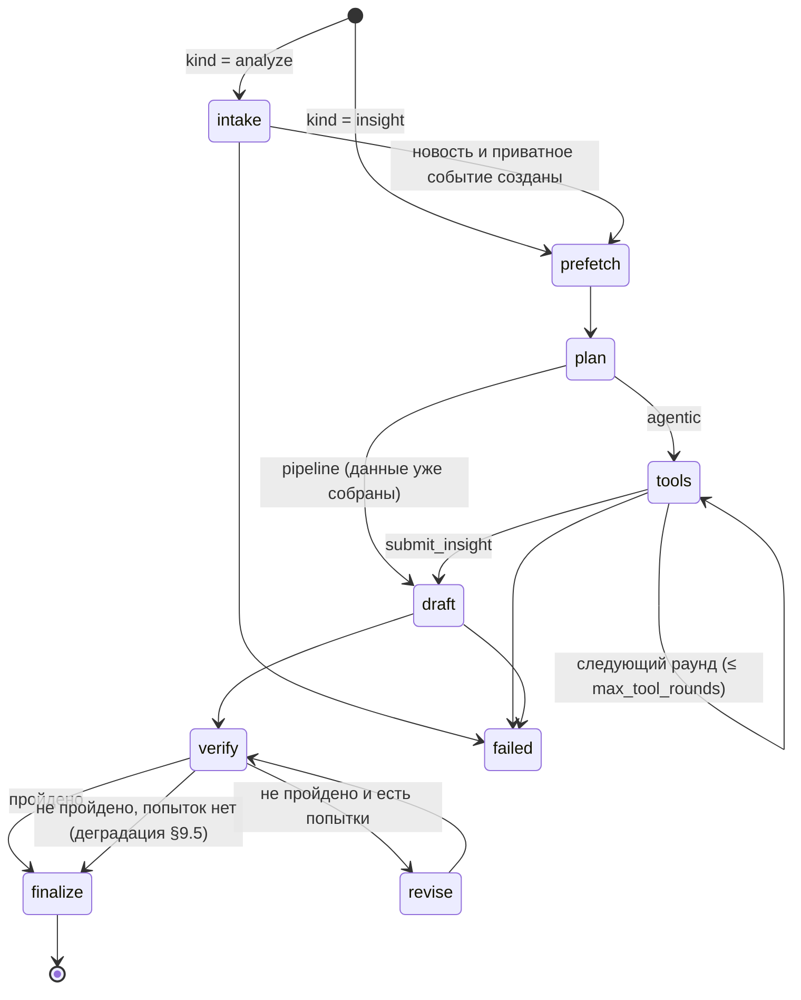

# 08. Агент: режимы, инструменты, схема инсайта, проверка

Агент — собственный цикл на `LLMRouter` (`04-llm.md`). Готовые агентные фреймворки запрещены условиями кейса. Код живёт в `backend/alfa_insight/agent/`.

## 1. Режимы и виды прогонов

### 1.1 Режимы

| Режим | План | LLM-вызовы | Где используется |
|---|---|---|---|
| `pipeline` | Фиксированный (§6): предзагрузка всех данных детерминированно | черновик → проверка → (доработка → проверка) | Прекомпьют в worker; генерация по запросу из ленты |
| `agentic` | Динамический: модель пишет план и сама выбирает инструменты (§7) | 2–4 раунда с инструментами → `submit_insight` → проверка → (доработка) | Фича B «Проверить новость»; чат |

Оба режима используют одни и те же компоненты: `EvidenceRegistry`, инструменты, `Verifier`, `Finalizer`, `TraceWriter`. В трассе одинаковые фазы. Если у моделей цепочки `agent` нет поддержки tools (по probe), режим `agentic` автоматически переходит в `pipeline`, и в трассе об этом есть запись.

### 1.2 Виды прогонов (`agent_runs.kind`)

| kind | Вход | Результат | Режим | Таймаут |
|---|---|---|---|---|
| `insight` | `event_id` (публичное событие из ленты) | `insights` | `pipeline` | 60 с |
| `analyze` | URL или текст (фича B) | приватное событие + `insights` | `agentic` | 60 с |
| `chat` | `insight_id` + вопрос | `chat_messages` | `agentic` (урезанный набор инструментов) | 30 с |

### 1.3 Прекомпьют (`services/jobs.py: enqueue_precompute`)

Каждые 15 минут worker делает следующее:

1. Берёт компании из `PRECOMPUTE_COMPANIES`: `demo` — из `config/demo.yaml`; `all` — все целевые; иначе список `company_id` через запятую.
2. Для каждой компании выбирает в её `default_role` до `precompute.top_k` событий из `rankings` со `score ≥ precompute.min_score`. Пропускаются события с `injection_suspected`, события, у которых уже есть инсайт с текущими `prompt_version` и `profile_version`, и события с прогоном в статусе `queued` или `running`.
3. Создаёт прогоны `kind=insight`, `mode=pipeline`, `status=queued`, `priority=precompute`. Демо-компании идут первыми, дальше по убыванию скора.
4. Выполняет очередь (`process_queue`): не больше 10 прогонов за тик, параллельно 2. Останавливается на `BudgetExceeded`.

## 2. Фазы и состояния прогона



Любая фаза может завершиться `failed` с кодом ошибки (§17). При `BudgetExceeded(scope="run")` в фазе `tools` агент сразу переходит к принудительному `submit_insight`. Если бюджета нет и на это — `failed`.

## 3. Контекст и лимиты

```python
# agent/context.py
class AgentLimits(BaseModel):
    max_tool_rounds: int = 3          # agentic: раундов с вызовами инструментов
    max_tool_calls: int = 8           # всего вызовов инструментов за прогон
    max_revisions: int = 1
    max_evidence: int = 30
    max_cost_rub: float = 5.0         # = LLM_MAX_RUN_COST_RUB
    timeout_s: int = 60
    evidence_text_chars: int = 1500   # длина текста одного evidence в промпте

@dataclass
class AgentContext:
    app: AppContext
    run_id: str
    kind: Literal["insight", "analyze", "chat"]
    mode: Literal["pipeline", "agentic"]
    company_id: str
    role: Role
    profile: CompanyProfile
    event_id: int | None
    priority: Priority
    limits: AgentLimits
    evidence: "EvidenceRegistry"
    trace: "TraceWriter"
    allowed_event_ids: set[int]       # события, к которым можно обращаться инструментами
    started_at: datetime
    cost_rub: float = 0.0
    tool_calls: int = 0
    exposure: Exposure | None = None  # результат compute_exposure по текущему событию
    path_eids: dict[str, str] = {}    # P1 → E-id пути — для chain_block и графа
```

`allowed_event_ids` изначально содержит текущее событие. Его пополняют только `event_id` из результатов `search_news`.

## 4. Evidence

```python
# agent/evidence.py
SourceKind = Literal["news", "alfa", "cbr", "client_data", "user_input"]

class EvidenceItem(BaseModel):
    eid: str                        # E1, E2, … — в порядке регистрации
    source_id: str                  # постоянный id, формат ниже
    kind: SourceKind
    title: str
    publisher: str | None = None
    url: str | None = None
    published_at: datetime | None = None
    text: str                       # что видит модель (обрезано до evidence_text_chars)
    numbers: list[float]            # нормализованные значимые числа из text (text/numbers.py)
    untrusted: bool                 # news, alfa, user_input → True
    meta: dict[str, Any] = {}       # page, doc_title, path_key, indicator, …
    full_text: str                  # до 4000 символов, не сериализуется — для open_evidence в чате

class EvidenceRegistry:
    def add(self, *, source_id: str, kind: SourceKind, title: str, text: str, **kw) -> EvidenceItem
        # повторный source_id → возвращает существующий элемент (тот же eid);
        # text_chars=… — свой лимит обрезки (профиль компании — 4000)
    def try_add(self, **kw) -> EvidenceItem | None      # при заполненном реестре (max_evidence) новый не добавляется
    def get(self, eid: str) -> EvidenceItem | None
    def all(self) -> list[EvidenceItem]
    def kind_label(self, item: EvidenceItem) -> str   # «Новость», «Аналитика Альфа-Банка», «Данные ЦБ», «Ваши данные», «Ваш текст»
```

**Формат `source_id`:**

| Вид | Формат | Пример |
|---|---|---|
| Новость | `news:{news_id}` | `news:4821` |
| Аналитика банка | `alfa:{slug}:p{page}:c{chunk_no}` | `alfa:macro-2026-09:p4:c2` |
| ЦБ | `cbr:{indicator}:{YYYY-MM-DD}` (дата последнего значения) | `cbr:key_rate:2026-10-22` |
| Профиль | `data:{company_id}:profile` | |
| Отраслевой срез платежей | `data:{company_id}:{supply|demand}:{industry_id|all}` | `data:SYN-DEMO-02:supply:metallurgy` |
| Путь влияния | `data:{company_id}:exposure:{event_id}:{channel}.{industry_id|factor_id}` | `data:SYN-DEMO-02:exposure:123:supply.metallurgy` |
| Фактор | `data:{company_id}:factor:{factor_id}` | |
| Группа | `data:{company_id}:group` | |
| Текст пользователя | `user:{news_id}` | |

При финализации все использованные evidence записываются в `sources` (upsert). Для `client_data` и `user_input` заполняется `sources.company_id`: такие источники выдаются только этой компании.

## 5. Инструменты (`agent/tools.py`)

### 5.1 Список

| Инструмент | Аргументы | Что делает | Evidence | Заголовок в трассе |
|---|---|---|---|---|
| `get_event` | `event_id: int` | Событие: заголовок, summary, тип, важность, горизонт, издания, теги; до 5 новостей с текстом | `news:*` на каждую новость | «Читаю материалы события» |
| `get_company_profile` | — | Краткий профиль и список признаков | `data:{cid}:profile` | «Смотрю профиль компании» |
| `compute_exposure` | `event_id: int` | Пути влияния (`07-ranking.md` §4) с крупнейшими контрагентами | `data:{cid}:exposure:…` на каждый путь | «Считаю цепную реакцию» |
| `get_counterparties` | `direction: suppliers\|buyers`, `industry_id?: str`, `limit: int = 5` (1..10) | Крупнейшие контрагенты и доли | `data:{cid}:{supply|demand}:{industry_id|all}` | «Смотрю ключевых контрагентов» |
| `search_news` | `query: str` (3..200), `days: int = 30` (1..180), `industry_ids: list[str] = []`, `limit: int = 5` (1..8) | BM25-поиск новостей (`06-ingestion-search.md` §13.2) | `news:*` на каждый результат | «Ищу связанные новости: „{query}“» |
| `search_alfa_research` | `query: str`, `industry_ids: list[str] = []`, `factor_ids: list[str] = []`, `limit: int = 4` (1..6) | Поиск по аналитике банка (`06-ingestion-search.md` §13.3) | `alfa:*` на каждый результат | «Ищу позицию аналитиков Альфа-Банка» |
| `get_macro` | `indicator: key_rate\|fx`, `currency?: USD\|EUR\|CNY\|TRY\|AED\|INR\|KZT`, `days: int = 90` (7..365) | Последнее значение, изменение за 7 и 30 дней, мин/макс, недельные точки | `cbr:{indicator}:{date}` | «Проверяю ключевую ставку» / «Проверяю курс CNY» |
| `get_related_group` | — | Компании той же группы (если есть `group_id`) | `data:{cid}:group` | «Смотрю компании группы» |
| `submit_insight` | `InsightDraft` | Терминальный: передаёт черновик | — | «Черновик готов» |
| `open_evidence` (только чат) | `eid: str` | Полный текст evidence, до 4000 символов | — | «Открываю источник» |
| `submit_answer` (только чат) | `ChatAnswer` | Терминальный ответ чата | — | — |

### 5.2 Реализация

```python
class ToolResult(BaseModel):
    ok: bool
    summary: str                          # одна строка: для трассы и для модели
    evidence: list[EvidenceItem] = []     # уже зарегистрированные (с eid)
    data: dict[str, Any] = {}             # структурированные данные (пути, ряды) — компактно
    error: str | None = None

class Tool(Protocol):
    name: str
    description: str                      # русское описание для модели (1–3 предложения)
    args_model: type[BaseModel]
    async def run(self, ctx: AgentContext, args: BaseModel) -> ToolResult: ...

TOOLS: dict[str, Tool]                    # реестр
def tool_specs(names: list[str]) -> list[ToolSpec]   # ToolSpec.parameters = to_llm_schema(args_model)
async def execute_tool_call(ctx: AgentContext, call: ToolCall) -> ToolResult
```

`execute_tool_call` выполняет шаги по порядку:

1. Проверить, что инструмент есть и разрешён для этого `kind`.
2. Проверить лимит `max_tool_calls`.
3. Провалидировать аргументы через `args_model` (ошибка → `ok=false`, текст ошибки модели, без исключения).
4. Проверить скоуп: `event_id ∈ ctx.allowed_event_ids`, `industry_id` и `factor_id` из справочника.
5. Выполнить с таймаутом 10 с.
6. Записать `tool.call` и `tool.result` в трассу.

Компания **всегда** берётся из `ctx.company_id`. В аргументах инструментов её нет, поэтому модель не может запросить чужие данные (ADR-23).

### 5.3 Формат результата для модели

Содержимое сообщения `tool` — компактный JSON, не длиннее 6000 символов (обрезка с пометкой `"truncated": true`):

```json
{"ok": true, "summary": "Найдено 3 фрагмента аналитики Альфа-Банка",
 "evidence": [{"eid": "E7", "kind": "alfa", "title": "Макроэкономический обзор, сентябрь 2026, с. 4",
               "date": "2026-09-15", "text": "<untrusted_document id=\"E7\" kind=\"alfa_research\">…</untrusted_document>"}],
 "data": {}}
```

Внешние тексты внутри результата обёрнуты в `untrusted` (`05-prompts.md` §1). Ошибка: `{"ok": false, "error": "Событие 991 недоступно в этом разборе"}`.

## 6. Режим pipeline: фиксированный план (`agent/pipeline_mode.py`)

1. `phase plan`: в трассу пишется событие `plan` с текстом «Пакетный режим: фиксированный план» и списком шагов.
2. `phase tools`, шаги 1–3 последовательно (дальнейшие шаги зависят от путей):
   1. `get_event(event_id)`
   2. `get_company_profile()`
   3. `compute_exposure(event_id)`
3. Параллельно (`asyncio.gather`):
   4. `search_alfa_research(query = заголовок + summary + названия отраслей и факторов первых трёх путей, industry_ids, factor_ids, limit=4)`
   5. `get_macro(key_rate)`, если среди путей или тегов события есть `key_rate` или `credit_conditions`
   6. `get_macro(fx, CUR)` для валютных факторов среди путей (не больше 2 валют)
   7. `get_counterparties(direction, industry_id, limit=3)`, если первый путь — `supply` или `demand`
4. `phase draft`: `router.structured(task="draft", schema=InsightDraft, messages=agent.system + draft.user, priority=ctx.priority)`. Кандидаты продуктов — §15.
5. `phase verify`, затем при необходимости `revise` (§9.4) и `finalize` (§10).

## 7. Режим agentic: цикл с инструментами (`agent/agentic_mode.py`)

```
prefetch: get_event, get_company_profile, compute_exposure       (как в pipeline, шаги 1–3)
messages = [system: agent.system, user: agent.user(evidence_block, chain_block, products_block)]
tools = [get_event, get_counterparties, search_news, search_alfa_research, get_macro,
         get_related_group, submit_insight]

for round in 1..max_tool_rounds:
    res = router.complete(task="agent", messages, tools, tool_choice="auto", priority=ctx.priority)
    if res.content: trace("plan" если round == 1, иначе "thought", текст ≤ 600 символов)
    if есть вызов submit_insight:
        draft = validate(InsightDraft, args)
        ok → выйти из цикла
        ошибка → tool-ответ с ошибками валидации; продолжить
    elif есть другие tool_calls:
        выполнить (параллельно, но не больше лимита), дописать assistant и tool-сообщения
    else:
        дописать user: «Вызови submit_insight с готовым InsightDraft.»
если черновика нет:
    res = router.complete(..., tool_choice={"type":"function","function":{"name":"submit_insight"}})   # принудительно
verify → (revise: дописать revise.user, ещё один раунд, затем принудительный submit) → finalize
```

- Если модель вернула и текст, и `tool_calls`, текст считается планом. Если раунд 1 пришёл без текста, план собирается из вызовов: «Проверю: позицию аналитиков банка; курс CNY».
- Несколько вызовов в одном ответе выполняются параллельно. Порядок tool-сообщений совпадает с порядком `tool_calls`.
- Каждый следующий вызов LLM проверяет бюджет прогона. При `BudgetExceeded(scope="run")` сразу идёт принудительный `submit_insight`.

## 8. Схема инсайта

### 8.1 Черновик от модели (`agent/schemas.py`)

```python
ClaimType = Literal["fact", "bank", "ai"]
Level = Literal["low", "medium", "high"]
Horizon = Literal["days", "weeks", "months", "quarters"]
Urgency = Literal["now", "this_week", "this_month", "monitor"]

class Claim(BaseModel):
    text: str = Field(min_length=8, max_length=400, description="Одно предложение")
    type: ClaimType
    refs: list[str] = Field(default_factory=list, max_length=6,
        description="В черновике — идентификаторы evidence (E1, E2…); в опубликованном инсайте — id источников")
    confidence: Level | None = Field(default=None, description="Обязательно для type=ai")

class WhatHappened(BaseModel):
    facts: list[Claim] = Field(min_length=1, max_length=4)            # type=fact
    assumptions: list[Claim] = Field(default_factory=list, max_length=3)   # type=ai

class WhyItMatters(BaseModel):
    summary: Claim
    client_features_used: list[str] = Field(min_length=1, max_length=8)
    chain_ids: list[str] = Field(default_factory=list, max_length=6)       # P1…

class Consequence(BaseModel):
    kind: Literal["risk", "opportunity"]
    title: str = Field(max_length=80)
    claim: Claim
    probability: Level
    impact: Level
    horizon: Horizon

class Action(BaseModel):
    title: str = Field(max_length=90)
    claim: Claim                                  # обоснование
    owner_role: Role
    urgency: Urgency
    product_id: str | None = None

class BankView(BaseModel):
    available: bool
    claims: list[Claim] = Field(default_factory=list, max_length=3)    # type=bank
    alignment: Literal["supports", "neutral", "contradicts", "no_data"]

class InsightDraft(BaseModel):
    headline: str = Field(max_length=110)
    why_you: str = Field(max_length=140)
    direction: Direction
    impact_level: ImpactLevel
    what_happened: WhatHappened
    why_it_matters: WhyItMatters
    consequences: list[Consequence] = Field(min_length=1, max_length=4)
    actions: list[Action] = Field(min_length=1, max_length=4)
    bank_view: BankView
```

В `agent.system.j2` (`05-prompts.md` §6) поле ссылок называется `refs`.

### 8.2 Опубликованный инсайт

```python
class SourceRef(BaseModel):
    id: str; kind: SourceKind; title: str
    publisher: str | None; url: str | None; published_at: datetime | None

class ProductOffer(BaseModel):
    product_id: str; name: str; pitch: str; url: str | None; action_index: int

class ConfidenceInfo(BaseModel):
    value: float; level: Level; reasons: list[str]

class VerificationSummary(BaseModel):
    passed: bool; supported_share: float; attempts: int
    removed_claims: int; warnings: list[str]; llm_skipped: bool

class EventBrief(BaseModel):
    id: int; title: str; summary: str; event_type: str; importance: int
    first_seen_at: datetime; last_seen_at: datetime
    publishers: list[str]; news_count: int
    visibility: Literal["public", "private"]; injection_suspected: bool

class Insight(InsightDraft):                      # те же блоки, refs уже = source_id
    id: str
    company_id: str
    status: Literal["published", "needs_review", "rejected"]
    event: EventBrief
    chain: ChainGraph                             # 07-ranking.md §11
    chain_preview: str | None
    sources: list[SourceRef]                      # все источники, на которые есть ссылки
    products: list[ProductOffer]
    confidence: ConfidenceInfo
    verification: VerificationSummary
    role_generated_for: Role
    prompt_version: str
    profile_version: str
    model: str
    trace_id: str                                 # = run_id
    cost_rub: float
    created_at: datetime
```

### 8.3 Соответствие 6 вопросам кейса (допущение A1)

| # | Вопрос | Блоки инсайта | Заголовок в UI |
|---|---|---|---|
| 1 | Что произошло? | `what_happened` | Что произошло |
| 2 | Почему это важно для вас? | `headline`, `why_you`, `why_it_matters`, `chain` | Почему это важно вам |
| 3 | Какие риски? | `consequences[kind=risk]` | Риски |
| 4 | Какие возможности? | `consequences[kind=opportunity]` | Возможности |
| 5 | Что делать? | `actions`, `products` | Что можно сделать |
| 6 | Что думает банк и на чём основан вывод? | `bank_view`, `sources`, `confidence`, трасса | Позиция Альфа-Банка · Источники |

Подписи берутся из одного словаря `frontend/src/lib/labels.ts`. Если формулировки кейса другие — меняются в одном месте. Если в инсайте нет ни одного риска (или ни одной возможности), блок показывается с текстом «Существенных рисков не видим» («Возможностей не видим»).

## 9. Проверка (`agent/verifier.py`)

### 9.1 Детерминированные проверки

Пути утверждений: `what_happened.facts[0]`, `what_happened.assumptions[1]`, `why_it_matters.summary`, `consequences[2].claim`, `actions[0].claim`, `bank_view.claims[0]`.

| code | Что проверяется | При нарушении |
|---|---|---|
| `refs_exist` | Все `refs` есть в реестре evidence | fail (утверждение) |
| `fact_has_source` | У `fact` есть хотя бы один ref вида `news`, `cbr`, `client_data` или `user_input` | fail |
| `bank_has_alfa` | У `bank` есть хотя бы один ref вида `alfa` | fail |
| `ai_has_confidence` | У `ai` задан `confidence` | warn, автоисправление: `medium` |
| `numbers_match` | Каждое значимое число в `fact` и `bank` есть среди чисел процитированных evidence (допуск ±0.5%) | fail для fact и bank, warn для ai |
| `features_exist` | `client_features_used` ⊂ ключей признаков профиля | неизвестные удаляются; если список опустел — fail |
| `chain_ids_exist` | `chain_ids` ⊂ id путей | warn, удалить лишние |
| `completeness` | facts ≥ 1, есть `why_it_matters.summary`, consequences ≥ 1, actions ≥ 1 | fail |
| `direction_consistent` | Направление инсайта не противоположно направлению из `compute_exposure` (`risk` против `opportunity`) | warn |
| `impact_consistent` | `impact_level` не выше уровня из ранжирования больше чем на одну ступень | warn, автоисправление: понизить |
| `products_valid` | `product_id` есть среди кандидатов | fail, `product_id` удаляется |
| `no_foreign_urls` | В текстах нет URL и доменов, которых нет у evidence | fail (утверждение) |
| `internal_ids` | В текстах нет служебных идентификаторов `E3`, `P1` (клиент их не видит) | warn, автоисправление: удалить |
| `banned_phrases` | Нет «гарантированно», «без риска», «100%», призывов купить или продать ценные бумаги | warn → замечание в доработку |
| `bank_view_consistency` | `available=true` ⇔ есть `claims` и alfa-evidence; иначе `alignment=no_data` | автоисправление |

**Значимые числа** (`text/numbers.py: extract_numbers(text) -> list[NumberMention]`) — числа с `%`, `п.п.`, `б.п.`, валютой (₽, руб., $, долл., евро, юан…), масштабом (тыс., млн, млрд, трлн), десятичной частью, а также целые ≥ 100, кроме годов 1990–2100 без единиц. Нормализация: запятая → точка, пробелы внутри числа удаляются, масштаб умножается. Совпадение — относительная разница ≤ 0.5% с любым числом из `evidence.numbers` процитированных evidence.

### 9.2 LLM-судья

Модель задачи `verify` (другое семейство, чем у черновика) вызывается с промптом `05-prompts.md` §10. На вход подаются все утверждения типов `fact`, `bank` и `ai`, а также только те evidence, на которые они ссылаются.

```python
class ClaimVerdict(BaseModel):
    path: str
    verdict: Literal["supported", "partial", "unsupported", "contradicted"]
    comment: str = Field(default="", max_length=200)

class VerifyLLMOutput(BaseModel):
    verdicts: list[ClaimVerdict]
    contradictions: list[str] = Field(default_factory=list, max_length=5)
    missing: list[str] = Field(default_factory=list, max_length=4)
```

Флаг `VERIFY_LLM_SKIP_IF_CLEAN=true` (экономия, по умолчанию `false`) пропускает судью, если все детерминированные проверки `pass`, а утверждений `fact` и `bank` не больше 6.

### 9.3 Отчёт и правило прохождения

```python
class CheckResult(BaseModel):
    code: str; status: Literal["pass", "warn", "fail"]; message: str; paths: list[str] = []

class VerificationReport(BaseModel):
    passed: bool
    attempt: int
    checks: list[CheckResult]
    verdicts: list[ClaimVerdict]
    contradictions: list[str]
    missing: list[str]
    supported_share: float        # среди fact и bank: supported = 1, partial = 0.5, остальное 0
    issues: list[str]             # инструкции для доработки, по-русски
    llm_skipped: bool
```

**Пройдено**, если одновременно: нет `fail`, `supported_share ≥ 0.8`, нет `contradicted`, и `missing` пуст **или** детерминированная `completeness` пройдена (живой судья склонен перечислять в `missing` пожелания; при заполненных блоках они только попадают в `issues`). Пункты `contradictions` вида «противоречий не выявлено» отбрасываются.

Утверждение с `fail` по проверкам, удаляющим утверждение (§9.5, п. 1), даёт 0. Утверждение без вердикта судьи даёт 1, если судья не вызывался (`llm_skipped`), и 0.5, если судья его пропустил. Вердикты по неизвестным путям отбрасываются.

`issues` формируются так: по строке на каждый `fail`, `partial`, `unsupported` и `contradicted`, затем `missing` и `contradictions`. Пример: «consequences[1].claim: числа „12%“ нет в E3 — убери его или возьми число из источника».

### 9.4 Доработка

Если проверка не пройдена и `attempt ≤ max_revisions`: фаза `revise` (промпт `05-prompts.md` §9), затем повторная проверка. В режиме `agentic` перед принудительным `submit_insight` разрешён один раунд инструментов.

### 9.5 Деградация после последней попытки

1. Удалить утверждения с `fail` по `refs_exist`, `fact_has_source`, `bank_has_alfa`, `numbers_match` и `no_foreign_urls`, а также с вердиктом `unsupported` или `contradicted`. Последствие или действие удаляется целиком вместе со своим `claim`.
2. `why_it_matters.summary` не удаляется. Если оно не подтверждено, тип меняется на `ai`, `confidence=low`, статус инсайта — `needs_review`.
3. Пустой обязательный блок (facts, consequences, actions) → `needs_review`. Чтобы инсайт оставался валидным по схеме, в таком блоке остаётся первый элемент с утверждением, понижённым до `ai`, `confidence=low`.
4. Иначе `published`, если `supported_share` после удаления ≥ 0.6, в противном случае `needs_review`.
5. Число удалённых утверждений записывается в `verification.removed_claims`. В UI плашка: «Часть выводов скрыта: не удалось подтвердить источниками».

## 10. Финализация (`agent/finalize.py`)

1. **Ссылки:** `refs` (E-id) → `source_id` из реестра; upsert `sources` (excerpt — первые 500 символов текста evidence, `payload_json` — `meta`); `insight_sources`.
2. **Граф цепочки:** `ChainGraph` из трёх первых путей `compute_exposure` (`07-ranking.md` §11). `source_ids` узлов — evidence путей и новости события.
3. **Продукты:** действия с валидным `product_id` → `ProductOffer` из каталога (`action_index` — индекс действия).
4. **Уверенность:**

```
v = supported_share (после деградации)
p = min(1, publisher_count / 3)          # независимые издания
t = max_trust события
k = покрытие данных по каналу первого пути (supply → coverage.supply, demand → coverage.demand, own/factor → 1.0)
g = tag_confidence события
confidence = 0.35·v + 0.20·p + 0.15·t + 0.15·k + 0.15·g
level = high, если ≥ 0.75; medium, если ≥ 0.5; иначе low;  needs_review → не выше low
```

`reasons` — 2–4 строки: «3 независимых источника», «данные о платежах покрывают 90%», «проверка: 9 из 10 утверждений подтверждены», «у аналитиков банка нет материалов по теме».

5. **Запись:** `insights` (`payload_json = Insight`, `verification_json = VerificationReport`), `agent_runs.status=succeeded`, `insight_id`, итоговые токены и стоимость, событие трассы `run.completed`.

`prompt_version` инсайта режима pipeline — `{draft}+{verify}` (`draft_v1+verify_v1`): смена любого из двух промптов делает старые инсайты устаревшими (`stale`). Судья исключает семейство модели, написавшей черновик (`LLMResult.family`).

## 11. Трасса (`agent/trace.py`)

```python
class TraceWriter:
    def __init__(self, db: SqliteDB, run_id: str) -> None: ...
    def emit(self, type: str, phase: str, title: str, *, status: str = "ok", payload: dict | None = None,
             model: str | None = None, tokens_in: int | None = None, tokens_out: int | None = None,
             cost_rub: float | None = None, latency_ms: int | None = None) -> int: ...   # возвращает seq
```

Каждая запись — отдельная короткая транзакция, `seq` монотонно растёт. Полные промпты и ответы в трассу **не пишутся**: только аргументы инструментов, короткие тексты и метрики. Полные запросы лежат в `llm_cache.request_json`.

| type | phase | Пример title | payload |
|---|---|---|---|
| `run.started` | intake / plan | Начинаю разбор события | `{kind, mode, event_id}` |
| `phase.started`, `phase.completed` | любая | Сбор данных | `{duration_ms}` |
| `intake.fetch` | intake | Загружаю статью: interfax.ru | `{domain, bytes, duration_ms}` |
| `intake.extract` | intake | Извлёк текст: 3 400 знаков | `{chars, title}` |
| `intake.security` | intake | В тексте найдена попытка управлять ИИ — игнорирую её | `{flags}` (status=warn) |
| `intake.tagged` | intake | Тема: пошлины; отрасли: металлургия, опт металлами | `{event_type, industries, factors, importance}` |
| `plan` | plan | План | `{text, steps: [{tool, why}]}` |
| `thought` | tools | Промежуточный вывод | `{text}` |
| `tool.call` | tools | Считаю цепную реакцию | `{tool, args}` |
| `tool.result` | tools | 34% закупок — металлургия; 3 пути влияния | `{tool, summary, eids, duration_ms, ok}` |
| `evidence.added` | tools | Источник: Интерфакс, 21.10 | `{eid, source_id, kind, title}` |
| `llm.call` | любая | DeepSeek-V4.1-Flash · черновик | `{task, model, tokens_in, tokens_out, cost_rub, cached, fallback_model_used}` |
| `draft.ready` | draft | Черновик готов: 11 утверждений | `{headline, claims}` |
| `verify.check` | verify | Числа сверены с источниками | `{code, status, message}` |
| `verify.report` | verify | Подтверждено 9 из 10 утверждений | `{passed, supported_share, issues}` |
| `revise.started` | revise | Дорабатываю: 2 замечания | `{issues}` |
| `budget.warning` | любая | Режим экономии бюджета | `{mode, spent_rub}` |
| `run.completed` | finalize | Готово за 17 с | `{insight_id \| message_id, duration_ms, cost_rub}` |
| `run.failed` | любая | Не удалось загрузить страницу | `{error_code, message}` |

## 12. Intake для фичи B (`agent/intake.py`)

```python
class AnalyzeInput(BaseModel):
    url: HttpUrl | None = None
    text: str | None = Field(default=None, min_length=200, max_length=20_000)
    title: str | None = Field(default=None, max_length=300)
    # model_validator: ровно одно из url или text
```

| Шаг | Действие | Цель по времени |
|---|---|---|
| 1 | URL уже есть в `news` (по `url_hash`), публичный, статус `tagged` или `clustered` → взять новость и событие, перейти к шагу 7 | 0.05 с |
| 2 | `safe_fetch(url)` (`11-security.md` §3). Ошибка → `fetch_failed`: «Сайт не отдал страницу. Вставьте текст новости» | 1–3 с |
| 3 | trafilatura: текст и метаданные (заголовок, дата, сайт). Меньше 300 символов → `unsupported_content` | 0.3 с |
| 4 | Нормализация и детектор инъекций → `intake.security` при срабатывании | 0.05 с |
| 5 | Разметка (`tagging_interactive`) | 2–4 с |
| 6 | `news(origin=user, owner_company_id, publisher=имя сайта или «Ваш текст»)`, приватное событие, `rank_one` → `rankings` | 0.1 с |
| 7 | Режим `agentic` (§7). При `relevance < 0.05` в `agent.user` добавляется пометка: «Связь события с компанией слабая (relevance=…): дай короткий разбор — что произошло, почему влияние на компанию минимально и за чем следить; impact_level = low» | 10–15 с |

Цель — первый шаг в интерфейсе через 1 с и готовый инсайт за 20 с. Жёсткий таймаут — 45 с, при нём `failed: timeout`.

Уточнения реализации: для вставленного текста порог шага 3 — 200 символов (как в `AnalyzeInput`). Если URL уже есть в базе как чужая приватная копия, своя новость пишется без `url` (уникальность `url_hash`). Строка `rankings` для приватного события пишется для трёх ролей даже при relevance ниже порога хранения. `prompt_version` инсайта режима agentic — `{agent}+{verify}`; при откате в pipeline — `{draft}+{verify}`.

## 13. Чат (`agent/chat.py`)

```python
class ChatAnswer(BaseModel):
    blocks: list[Claim] = Field(min_length=1, max_length=5)
    followups: list[str] = Field(default_factory=list, max_length=3)
```

1. Загрузить инсайт (проверить компанию сессии) и его `sources`. Восстановить реестр evidence в порядке источников инсайта: E1..En. Тексты берутся из исходных таблиц: `news.body`, `research_chunks.text`, `macro_series`, `sources.excerpt` для `client_data`.
2. История треда — последние 6 сообщений.
3. Цикл как в §7, до 3 раундов. Инструменты: `open_evidence`, `search_news`, `search_alfa_research`, `get_macro`, `get_counterparties`, `compute_exposure` (только текущее событие), `submit_answer`.
4. Детерминированные проверки из §9.1: `refs_exist`, `fact_has_source`, `bank_has_alfa`, `numbers_match`, `no_foreign_urls`. Не прошедший блок удаляется. Если удалены все, ответ заменяется одним блоком `ai`: «Не могу ответить на это с опорой на источники». LLM-судья в чате не вызывается ради скорости.
5. Сохранить `chat_messages(role=assistant, content_json = ChatAnswer с refs → source_id)`, сделать upsert новых `sources`, `run.completed {message_id}`.

Сборка сообщений: `system` + `chat.user` (контекст инсайта и **первый** вопрос окна из 6 последних сообщений) + остальная история (вопросы — текстом, ответы — текстом блоков) + текущий вопрос. Так контекст инсайта есть в каждом запросе, даже если начало треда выпало из окна. Цикл — тот же `AgentLoop`, что в §7 (терминальный инструмент `submit_answer`); `compute_exposure` в чате разрешён только для события инсайта. Сообщение пользователя пишется в `chat_messages` до запуска прогона (`start_chat` → `user_message_id`).

## 14. Брифинг роли (`agent/briefs.py`)

```python
class BriefItem(BaseModel):
    status: Literal["ready", "pending"]
    event_id: int
    insight_id: str | None
    headline: str                  # для pending — заголовок события
    why_you: str | None            # для pending — chain_preview
    direction: Direction
    impact_level: ImpactLevel
    action: Action | None          # первое действие с owner_role == роль, иначе первое
    product: ProductOffer | None

class Brief(BaseModel):
    role: Role
    items: list[BriefItem]         # до 3
    reading_time_s: int            # слова / 200 в минуту
    generated_at: datetime
```

Брифинг берёт первые 10 строк `rankings` по `(company, role)`. Готовые инсайты идут первыми, если их скор не ниже скора pending-события больше чем в 1.5 раза. Затем первые 3 элемента. LLM не используется. Готовым считается только инсайт со статусом `published` (на проверке — показывается как pending). Сортировка: `score × 1.5` для готовых, `score` для pending.

## 15. Продукты банка (`config/products.yaml`, `products/catalog.py`)

```yaml
version: 1
disclaimer: "Названия продуктов обобщённые; условия уточняйте у менеджера банка."
products:
  - id: fx_hedge_forward
    name: Валютный форвард
    pitch: Зафиксируйте курс будущих платежей и уберите валютный риск из бюджета.
    roles: [treasurer, cfo]
    triggers: [{channel: factor, factor_prefix: "fx_", direction: risk}]
    conditions: {ved: true}
  - id: ved_payments
    name: Расчёты по ВЭД и валютный контроль
    pitch: Проводите платежи партнёрам за рубежом через отлаженные каналы и с сопровождением валютного контроля.
    roles: [treasurer]
    triggers: [{channel: factor, factor: cross_border_payments, direction: risk},
               {channel: factor, factor: sanctions, direction: risk}]
    conditions: {ved: true}
  - id: letter_of_credit
    name: Аккредитив
    pitch: Снизьте риск непоставки и предоплаты в сделках с новыми поставщиками.
    roles: [cfo, treasurer]
    triggers: [{channel: supply, effect: supply_down}, {channel: factor, factor: sanctions, direction: risk}]
  - id: trade_finance
    name: Торговое финансирование ВЭД
    pitch: Получите отсрочку платежа зарубежному поставщику под покрытие банка.
    roles: [treasurer, cfo]
    triggers: [{channel: factor, factor: customs_tariffs, direction: risk}, {channel: supply, effect: prices_up}]
    conditions: {ved_direction: import}
  - id: credit_line_working_capital
    name: Кредитная линия на пополнение оборотных средств
    pitch: Закупите сырьё и товар заранее, до роста цен, без отвлечения собственных средств.
    roles: [cfo]
    triggers: [{channel: supply, effect: prices_up}, {channel: demand, effect: demand_up}, {channel: own, effect: demand_up}]
  - id: interest_rate_hedge
    name: Фиксация процентной ставки
    pitch: Защитите долг с плавающей ставкой от роста ключевой ставки.
    roles: [treasurer, cfo]
    triggers: [{channel: factor, factor: key_rate, event_direction: up}]
    conditions: {products: [credit]}
  - id: refinancing
    name: Рефинансирование кредитов
    pitch: Пересоберите долговой портфель под новые условия ставок.
    roles: [cfo, treasurer]
    triggers: [{channel: factor, factor: key_rate, event_direction: down}]
    conditions: {products: [credit]}
  - id: deposit_placement
    name: Размещение свободных средств
    pitch: Получайте доход на остатки, пока ставки высокие.
    roles: [treasurer]
    triggers: [{channel: factor, factor: key_rate, event_direction: up}]
  - id: factoring
    name: Факторинг
    pitch: Получайте деньги за отгрузку сразу, не дожидаясь оплаты покупателей.
    roles: [cfo, treasurer]
    triggers: [{channel: demand, effect: demand_down}, {channel: demand, effect: costs_up},
               {channel: factor, factor: payment_discipline, direction: risk}]
  - id: bank_guarantee
    name: Банковская гарантия
    pitch: Участвуйте в госзакупках и крупных тендерах без заморозки собственных средств.
    roles: [owner, cfo]
    triggers: [{channel: factor, factor: gov_spending, direction: opportunity}, {channel: own, effect: support_measures}]
  - id: leasing
    name: Лизинг техники и оборудования
    pitch: Обновите парк техники и оборудования без крупных единовременных затрат.
    roles: [owner, cfo]
    triggers: [{channel: own, effect: demand_up}, {channel: own, effect: support_measures}]
  - id: project_finance_escrow
    name: Проектное финансирование с эскроу-счетами
    pitch: Финансируйте строительство под поступления на эскроу-счета покупателей.
    roles: [owner, cfo]
    triggers: [{channel: factor, factor: mortgage_market}, {channel: own, effect: demand_up}]
    conditions: {industries: [construction_buildings]}
  - id: cash_management
    name: Управление ликвидностью группы
    pitch: Соберите остатки компаний группы и управляйте ликвидностью из одного окна.
    roles: [treasurer]
    triggers: [{channel: factor, factor: credit_conditions, direction: risk}, {channel: factor, factor: payment_discipline, direction: risk}]
```

**Срабатывание** (`match_products(exposure, profile, role) -> list[ProductCandidate]`):

- Проверяются первые 5 путей. Триггер совпадает с путём, если совпадают канал и все указанные поля:
  - `effect` — для отраслевых каналов;
  - `factor` или `factor_prefix`;
  - `direction` — направление пути;
  - `event_direction` — `up`/`down` по направлению фактора в событии.
- Условия: `ved` (есть хотя бы одна страна ВЭД), `ved_direction`, `products` (все перечисленные есть у компании), `industries` (основная отрасль в списке).
- Скор кандидата — максимальный вклад совпавшего пути × 1.2, если роль из `roles`. Отбираются 3 лучших.

`ProductCandidate(product_id, name, pitch, when: str)` передаётся в `products_block`. Поле `when` — строка «когда уместен», её собирает шаблон из совпавшего триггера.

## 16. Латентность и стоимость

| Прогон | Вызовы LLM | Цель p50 | Жёсткий лимит |
|---|---|---|---|
| `insight` (pipeline) | draft + verify (+ revise + verify) | 12 с | 60 с |
| `analyze` (agentic) | tagging + 2–3 раунда agent + verify | 20 с | 45 с (intake + анализ) |
| `chat` | 1–3 раунда | 6 с | 30 с |

Ускорения:
- параллельные инструменты;
- verify в одном вызове на все утверждения;
- в агентном режиме предзагрузка обязательных инструментов без участия модели;
- кеш LLM;
- SSE отдаёт шаги сразу.

## 17. Коды ошибок прогона

| `error_code` | Когда | Сообщение пользователю |
|---|---|---|
| `llm_unavailable` | Все модели цепочки недоступны | Сервис аналитики временно недоступен, попробуйте позже |
| `budget_exhausted` | `BudgetExceeded(scope=day/reserve)` | Дневной лимит аналитики исчерпан, показываем готовые разборы |
| `invalid_output` | `LLMInvalidOutput` после всех моделей | Не удалось подготовить разбор, попробуйте ещё раз |
| `fetch_failed` | Ошибка `safe_fetch` | Сайт не отдал страницу. Вставьте текст новости |
| `unsupported_content` | Текст слишком короткий или не HTML | Не удалось извлечь текст статьи. Вставьте текст вручную |
| `blocked_url` | SSRF-проверка | Этот адрес нельзя загрузить |
| `timeout` | Превышен таймаут прогона | Разбор занял слишком много времени, попробуйте ещё раз |
| `interrupted` | Процесс перезапущен во время прогона | Разбор прерван, запустите заново |
| `internal` | Прочее | Внутренняя ошибка |
